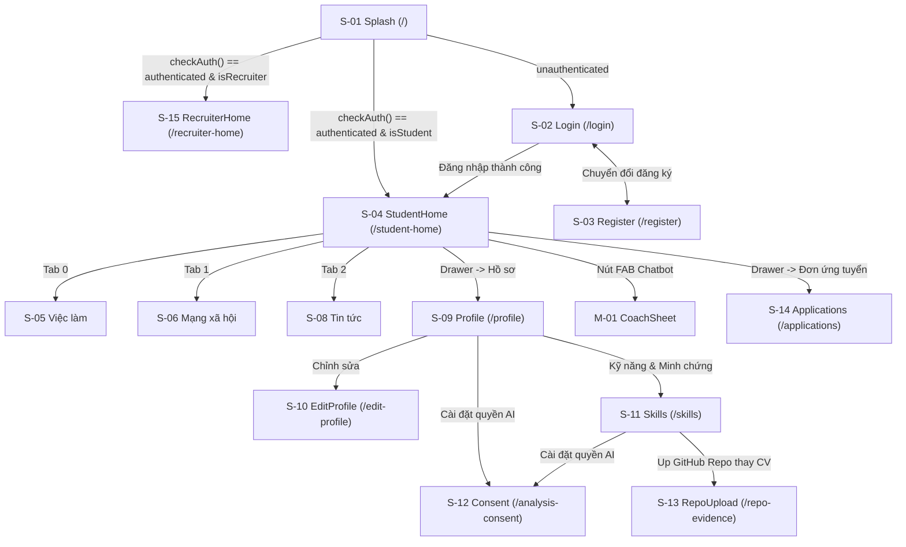

# Bản đồ Màn hình & Luồng Điều hướng (SCREENS.md)

## 1. Bảng Bản đồ Màn hình
| ID | Route | File màn hình | ViewModel | Tính năng | Từ đâu vào | Cổng chặn (Guard) | Trạng thái |
|---|---|---|---|---|---|---|---|
| S-01 | `/` | `features/auth/.../splash_screen.dart:8` | `AuthProvider` | F-001 | Khởi động app | Check auth token | Có code |
| S-02 | `/login` | `features/auth/.../login_screen.dart:18` | `AuthProvider` | F-001 | Splash / Đăng xuất | Chưa đăng nhập | Có code |
| S-03 | `/register` | `features/auth/.../register_screen.dart:19` | `AuthProvider` | F-001 | Từ màn Login | Chưa đăng nhập | Có code |
| S-04 | `/student-home` | `features/student_home/student_home_screen.dart:20` | `AuthProvider` + Tabs | F-002 | Splash / Login | Auth + Role Student | Có code |
| S-05 | Tab 0 (Home) | `features/jobs/.../job_list_screen.dart:16` | `JobProvider` | F-003 | Bottom Bar Tab 0 | Auth | Có code |
| S-06 | Tab 1 (Home) | `features/social/.../social_feed_screen.dart:15` | `SocialFeedProvider` | F-004 | Bottom Bar Tab 1 | Auth | Có code |
| S-07 | `/create-post` | `features/social/.../create_post_screen.dart:16` | `SocialFeedProvider` | F-004 | Nút tạo bài viết | Auth | Có code |
| S-08 | Tab 2 (Home) | `features/news/.../news_page.dart:15` | `NewsProvider` | F-005 | Bottom Bar Tab 2 | Auth | Có code |
| S-09 | `/profile` | `features/profile/profile_page.dart:24` | `CvProvider`, `LocaleVM` | F-002 | Drawer / Avatar bar | Auth | Có code |
| S-10 | `/edit-profile`| `features/profile/edit_profile_page.dart:15` | `ProfileEditViewModel` | F-002 | Nút Sửa từ Profile | Auth | Có code |
| S-11 | `/skills` | `features/skills/.../skills_screen.dart:18` | `SkillsViewModel` | F-008-010 | Profile / Drawer | Auth | Có code |
| S-12 | `/analysis-consent`| `features/consent/.../analysis_consent_screen.dart:15`| `ConsentViewModel` | F-006 | Profile / Up Repo | Auth | Có code |
| S-13 | `/repo-evidence`| `features/skills/.../repo_upload_screen.dart:17`| `RepoUploadViewModel`| F-008 | Màn Skills / Profile| Auth + Consent | Có code |
| S-14 | `/applications`| `features/applications/applications_page.dart:13` | `StudentApplicationsProvider`| F-007 | Menu Drawer | Auth | Có code |
| S-15 | `/recruiter-home`| `features/recruiter_home/recruiter_home_screen.dart:14`| `AuthProvider` | F-011 | Splash / Login | Auth + Role Recruiter| Có code |
| M-01..06| BottomSheets | `features/coach/.../coach_sheet.dart:25`, `job_detail_sheet.dart:19`, `job_filter_sheet.dart:15`, `comments_sheet.dart:15`, `reactors_sheet.dart:14`, `share_sheet.dart:14` | Sheet Providers | F-003,004,013 | Nút nổi / chạm thẻ | Auth | Có code |

## 2. Sơ đồ Điều hướng & Guards (Mermaid)

## 3. Chi tiết Từng Nhóm Màn hình Code Thực tế
### S-01: Splash Screen (`splash_screen.dart:8`)
- **Mục đích**: Kiểm tra phiên đăng nhập và định tuyến người dùng (`splash_screen.dart:46-56`).
- **Cây widget**: `Scaffold` > `Center` > `Consumer<AuthProvider>` > `Column` > Logo LinkedIn Container (`:84`), Tên App (`:105`), Loading/Error Column (`:116`).
- **Dữ liệu**: `authProvider.status`, `errorMessage` (`:75-125`).
- **Hành động**: Gọi `authProvider.checkAuth()` sau frame đầu (`:36`); nút "Thử lại kết nối" (`:135`); nút "Chuyển đến Đăng nhập" (`:154`).
- **Trạng thái**: Loading (`:164`), Error (`:116`), Authenticated (`:46`), Unauthenticated (`:53`). Ngoại tuyến: không tự kick ra login (`:88`). Hết hạn mức: KHÔNG có.
- **Form/l10n**: Không có form. Hardcode chuỗi tiếng Việt (`:106, 126, 139, 158`).
- **A11y/Responsive/Test**: Semantics mặc định, min-touch 48dp cho nút thử lại (`:140`). Không xoay màn. Test: `auth_provider_test.dart:1`. Điều chưa rõ: UNKNOWN (cần ảnh chụp splash logo).

### S-02 & S-03: Login & Register (`login_screen.dart:18`, `register_screen.dart:19`)
- **Mục đích**: Xác thực người dùng bằng Email/Password hoặc Google/GitHub SSO; Đăng ký tài khoản chọn role Sinh viên / Nhà tuyển dụng.
- **Cây widget**: `Scaffold` > `SafeArea` > `SingleChildScrollView` > `Column` > AppLogo, `TextFormField` (email, password, role switch), SSO Buttons (`GoogleSignInButton`, GitHub button).
- **Dữ liệu**: `authProvider.isLoading`, `authProvider.errorMessage`.
- **Hành động**: Submit login (`loginUseCase`), SSO login, điều hướng sang `/register` hoặc `/student-home`.
- **Trạng thái**: Loading (nút disable), Error (hiện Banner/SnackBar), Thành công (pushReplacement).
- **Form**: Email regex, password length >= 6.
- **A11y/Test**: Vùng chạm button đạt 48dp. Test: `google_sign_in_button_test.dart:1`, `auth_provider_test.dart:1`.

### S-04..08: Student Home & Tabs (`student_home_screen.dart:20`, `job_list_screen.dart:16`, `social_feed_screen.dart:15`, `news_page.dart:15`)
- **Mục đích**: Không gian trung tâm sinh viên tìm việc, đọc tin tức chuyên ngành và tương tác mạng xã hội tuyển dụng.
- **Cây widget**: `Scaffold` > Drawer (Avatar, Tên, Menu chuyển hướng, Đăng xuất) + `IndexedStack` (3 tabs) + `NavigationBar` (3 destinations: Việc làm, Mạng xã hội, Tin tức) + FAB (Coach Bot).
- **Dữ liệu**: `JobProvider.jobs`, `SocialFeedProvider.posts`, `NewsProvider.articles`, `AuthProvider.currentUser`.
- **Hành động**: Chuyển tab bottom bar; lọc việc làm; like (6 biểu cảm)/bình luận/chia sẻ bài viết; mở CoachSheet chatbot.
- **Trạng thái**: Xử lý đầy đủ Shimmer loading (`AppSkeleton`), Empty view, Error retry, Infinite scroll pagination.
- **Responsive**: `job_list_screen.dart:40-42` chia 1 cột (<600dp), 2 cột (<900dp), 3 cột (>=900dp) giới hạn max-width 1200dp.

### S-09 & S-10: Profile & Edit Profile (`profile_page.dart:24`, `edit_profile_page.dart:15`)
- **Mục đích**: Quản lý hồ sơ ứng viên, đổi ngôn ngữ tức thì, tải CV PDF và điều chỉnh quyền riêng tư dữ liệu (Private by default).
- **Cây widget**: `Scaffold` > `AppBar` (chứa `LanguageSwitchButton`) > `SingleChildScrollView` > `ProfileHeader`, CV Upload Card, `SwitchListTile` ("Hồ sơ riêng tư"), Action Buttons.
- **Dữ liệu**: `ProfileEditViewModel.fullName`, `isPrivate`, `LocaleViewModel.locale`, `CvProvider.cvs`.
- **Hành động**: Bật tắt switch riêng tư (`setPrivate`), lưu hồ sơ (`saveProfile`), bấm cờ chuyển ngôn ngữ (`toggleLanguage`).
- **Trạng thái**: Loading indicator, Form dirty check, Success toast.
- **l10n**: 100% ARB qua `context.l10n` (`edit_profile_page.dart:25-104`).

### S-11..13: Kỹ năng 3 cấp độ, Consent AI & Up Repo (`skills_screen.dart:18`, `analysis_consent_screen.dart:15`, `repo_upload_screen.dart:17`)
- **Mục đích**: Minh bạch kỹ năng theo 3 cấp độ tin cậy (F-008-010), bảo vệ quyền riêng tư AI 0 USD (F-006) và quét kỹ năng qua GitHub Repository.
- **Cây widget**: `Scaffold` > `AppBar` > `ListView` > `ConfidenceBadge` (`verified`, `evidence`, `self_claimed`), Card minh bạch dữ liệu AI (đọc gì vs KHÔNG đọc gì), Text field nhập URL GitHub Repo + Scan button.
- **Dữ liệu**: `SkillsViewModel.skills`, `ConsentViewModel.hasConsented`, `RepoUploadViewModel.repoUrl`.
- **Hành động**: Nhập link repo -> validate định dạng `github.com/owner/repo` -> kiểm tra Consent -> kích hoạt quét kỹ năng -> cập nhật danh sách kỹ năng tức thì.
- **Trạng thái**: Guard kiểm tra consent; chặn quét nếu chưa đồng ý; cảnh báo repo không hợp lệ.
- **A11y/Test**: Đạt chuẩn Semantics, touch target 48dp. Test: `confidence_badge_a11y_test.dart`, `analysis_consent_a11y_test.dart`, `repo_upload_view_model_test.dart`.

