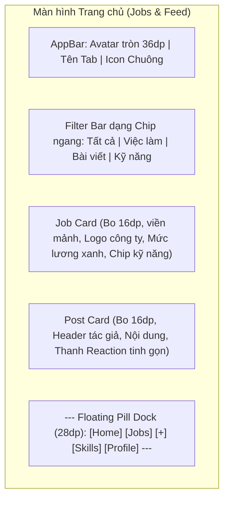

# Ba Hướng Thiết Kế Giao Diện (01-DIRECTIONS.md) - Cổng G1

Tài liệu đệ trình chủ dự án tại **Cổng G1** để lựa chọn 1 hướng thiết kế chủ đạo cho toàn bộ ứng dụng MiniLinkedIn.

---

## Hướng 1: Clay-inspired Executive Minimalist (Khuyến nghị hàng đầu)

### 1. Nguyên tắc cốt lõi
- **Subtle Luxury & Clean Space**: Nền sáng thanh khiết (`#FFFFFF`/`#F8FAFC`), triệt tiêu viền đậm và bóng gắt, tối đa hóa khoảng trắng để nội dung "thở".
- **Floating Dock Navigation**: Thanh điều hướng nổi dạng pill bo tròn (`Radius: 28dp`) với hiệu ứng kính mờ (frost blur), giữ nguyên không gian cuộn tràn viền.
- **Structured Categorization**: Tổ chức bộ lọc và dữ liệu theo danh mục hai cột rõ ràng (lấy cảm hứng từ màn Search của Clay: `BY ROLE`, `BY SKILL`, `BY LOCATION`).
- **AI Navigator Tinh Tế**: Chatbot hiển thị dạng thẻ gợi ý câu hỏi bo cong mềm mại (`ChatSuggestions`), có dải gradient phát sáng nhẹ ở chân trang khi bot xử lý.

### 2. Ngôn ngữ thị giác & Mật độ
- **Mật độ thông tin**: Thoáng đãng, thanh lịch (Spacious / Comfortable).
- **Màu sắc**: Màu nhấn thương hiệu `#2952CC` (Indigo), nền chữ `#0F172A` (Slate 900), nền phụ `#F1F5F9` (Slate 100), viền siêu mảnh `#E2E8F0`.
- **Typography & Hình khối**: Tiêu đề sắc sảo kết hợp font `Be Vietnam Pro`; bo góc lớn `16-20dp` cho thẻ và `28dp` cho floating dock.

### 3. Thể hiện "Tin cậy" & "Riêng tư"
- **3 Cấp độ tin cậy**: Huy hiệu pill mỏng tối giản kèm micro-icon ngữ nghĩa: `[✓ Đã xác minh]` (xanh dương), `[⎇ Có minh chứng Git]` (xám viền mảnh), `[👤 Tự khai]` (nét đứt nhẹ).
- **Riêng tư mặc định**: Banner ổ khóa bảo vệ tinh tế ở đầu hồ sơ: *"Hồ sơ được bảo vệ riêng tư theo mặc định"*.

### 4. Wireframe Bố cục Tiêu biểu (Mermaid)

### 5. Đánh giá & Rủi ro
- **Ưu điểm**: Thẩm mỹ cao cấp, khớp 100% với hình ảnh tham khảo của Clay mà chủ dự án đã gửi, tạo sự khác biệt vượt trội so với các app việc làm đại trà.
- **Nhược điểm & Rủi ro**: Cần xử lý fallback nền đặc nếu thiết bị Android quá cũ không render nổi `BackdropFilter`.
- **Chi phí triển khai**: **Vừa (Medium)** - 100% dùng widget tiêu chuẩn của Flutter, không cần package ngoài.

---

## Hướng 2: Developer Tech-Hub (Linear / Raycast Style)

### 1. Nguyên tắc cốt lõi
- **Data-Dense & High Velocity**: Mật độ thông tin cao, hiển thị tối đa dữ liệu trên một màn hình, giảm cuộn trang.
- **Monospace Accentuation**: Điểm xuyết font dạng mã nguồn cho tag kỹ năng, commit hash và số liệu lương.
- **Sharp Geometry**: Bo góc nhỏ sắc gọn (`6-8dp`), đường kẻ phân cách 1px dứt khoát.

### 2. Ngôn ngữ thị giác & Mật độ
- **Mật độ thông tin**: Dày đặc (Compact / High-density).
- **Màu sắc**: Xanh Navy công nghệ `#1E3A8A`, viền kim loại `#CBD5E1`, nền `#F8FAFC`.
- **Typography & Hình khối**: `Be Vietnam Pro` kết hợp font monospace; bo góc nhỏ `6-8dp`.

### 3. Thể hiện "Tin cậy" & "Riêng tư"
- **Tin cậy**: Thể hiện như commit badge trên GitHub: `[PR #14 Verified]` hoặc `[sha256: 3 skills]`.
- **Riêng tư**: Tag trạng thái góc phải thẻ: `[LOCKED: PRIVATE]`.

### 4. Đánh giá & Rủi ro
- **Ưu điểm**: Rất chuyên nghiệp đối với lập trình viên lâu năm; cấu trúc dạng bảng/danh sách dễ tra cứu.
- **Nhược điểm**: Có thể khô khan và gây ngợp với sinh viên năm nhất hoặc nhà tuyển dụng HR.
- **Chi phí triển khai**: **Vừa (Medium)**.

---

## Hướng 3: Approachable Career Companion (Warm & Friendly Mentorship)

### 1. Nguyên tắc cốt lõi
- **Warm & Welcoming**: Tông màu ấm áp, xua tan căng thẳng nộp CV và tìm việc đầu đời.
- **Gamified Roadmap**: Lộ trình kỹ năng trực quan hóa dạng cây tiến trình và các mốc huy hiệu vinh danh.
- **Soft Organic Shapes**: Bo góc siêu mềm (`18-24dp`), bóng đổ đa tầng nhẹ nhàng.

### 2. Ngôn ngữ thị giác & Mật độ
- **Mật độ thông tin**: Dàn trải, dễ tiếp nhận (Comfortable to Low density).
- **Màu sắc**: Xanh Indigo kết hợp vàng cam mật ong ấm `#F59E0B` và xanh ngọc bảo hộ `#10B981`.
- **Typography & Hình khối**: Nét chữ tròn trịa, thân thiện; thẻ card dày dặn, bo tròn lớn.

### 3. Thể hiện "Tin cậy" & "Riêng tư"
- **Tin cậy**: Huy hiệu hình chiếc khiên bảo vệ màu sắc nổi bật.
- **Riêng tư**: Minh họa chiếc khiên kèm thông điệp khích lệ: *"Dữ liệu của bạn được bảo mật an toàn 100%"*.

### 4. Đánh giá & Rủi ro
- **Ưu điểm**: Rất thân thiện với tân sinh viên; chatbot cho cảm giác như một người thầy tận tâm.
- **Nhược điểm**: Dễ bị xem như một ứng dụng học tập thay vì một nền tảng nghề nghiệp nghiêm túc; tốn công sức vẽ icon/minh họa.
- **Chi phí triển khai**: **Lớn (Large)**.

---

## 4. Bảng So Sánh Tổng Hợp

| Tiêu chí | Hướng 1: Clay Executive Minimalist | Hướng 2: Developer Tech-Hub | Hướng 3: Warm Career Companion |
|---|---|---|---|
| **Mật độ thông tin** | Vừa phải, thoáng đãng | Cao, dày đặc | Dàn trải, dễ đọc |
| **Cá tính giao diện** | Tinh tế, hiện đại, thanh lịch | Sắc nét, kỹ thuật cao | Thân thiện, ấm áp, khích lệ |
| **Thanh điều hướng** | Floating Pill Dock (mờ kính 28dp)| Standard Bottom Bar (sắc cạnh 0dp)| Rounded Bottom Bar (bo góc trên) |
| **Độ khớp ảnh tham khảo**| ⭐⭐⭐⭐⭐ (Khớp 100% ảnh Clay) | ⭐⭐ (Hơi khô khan) | ⭐⭐⭐ (Thiếu chất Executive) |
| **Chi phí triển khai** | Vừa (Medium) | Vừa (Medium) | Lớn (Large) |
| **Rủi ro kỹ thuật** | Thấp (chỉ cần fallback blur) | Thấp | Trung bình (cần tài nguyên đồ họa) |

---

## 5. Khuyến Nghị Của Agent & Quyết Định Cổng G1

> [!TIP]
> **Khuyến nghị**: Agent đề xuất chủ dự án lựa chọn **Hướng 1: Clay-inspired Executive Minimalist**.
> 
> *Lý do*:
> 1. Đồng bộ hoàn hảo với 4 ảnh chụp ứng dụng Clay mà chủ dự án đã gửi làm chuẩn tham khảo.
> 2. Giúp nâng tầm định vị của MiniLinkedIn thành một mạng lưới nghề nghiệp cao cấp, đáng tin cậy.
> 3. Tận dụng trọn vẹn sức mạnh của component `ChatSuggestions` (chuẩn 21st.dev) vừa tích hợp cho chatbot.
> 4. Chi phí triển khai tối ưu và an toàn, hoàn toàn không cần thêm bất kỳ thư viện thứ ba nào.

👉 **DỪNG TẠI CỔNG G1**: Chờ chủ dự án lựa chọn hướng thiết kế chính thức (Hướng 1, Hướng 2, hoặc Hướng 3).

