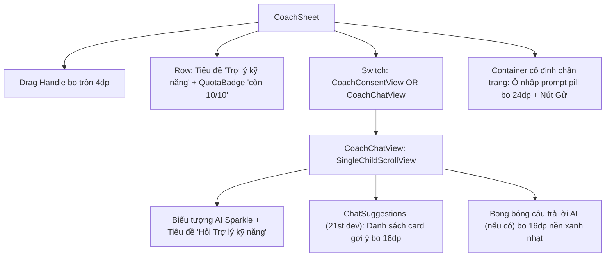

# Đặc Tả Màn Hình: M-01 Trợ Lý Kỹ Năng AI (M-01-COACH-BOT.md)

Lô 3 - Màn 5: Modal Trợ lý cố vấn kỹ năng & lộ trình nghề nghiệp sinh viên (`docs/SPEC.md:F-013`).

---

## 1. Mục Tiêu Người Dùng & Tác Vụ Chính
- **Mục tiêu**: Nhận tư vấn lộ trình học tập kỹ năng công nghệ, gợi ý dự án thực chiến và giải đáp thắc mắc phỏng vấn hoàn toàn miễn phí từ AI nội bộ (`F-013`).
- **Tác vụ chính**: Xem và chọn nhanh các câu hỏi gợi ý thông minh; nhập câu hỏi tư vấn tự do; theo dõi số lượt câu hỏi còn lại trong ngày (10 câu/ngày); đồng ý điều khoản sử dụng AI nội bộ 0 USD.

---

## 2. Thay Đổi So Với Hiện Tại & Lý Do
- **Cũ (`coach_sheet.dart:25`, `coach_chat_view.dart:15`)**:
  - Giao diện khung chat cơ bản; ô gợi ý câu hỏi xếp thô; thiếu điểm nhấn thị giác đẳng cấp của một trợ lý AI thông minh.
- **Mới (Kết hợp cảm hứng Clay Nexus & Mẫu 21st.dev `chat-suggestions`)**:
  - Khung BottomSheet bo trên 24dp, tay kéo mềm mại, chiều cao 85% màn hình với nền trắng tuyết.
  - Huy hiệu hạn mức `QuotaBadge` bo 12dp ở góc trên phải: `còn 10/10 câu hôm nay` màu xanh dương nhẹ (hoặc đỏ nhạt khi hết lượt), minh bạch chi phí AI nội bộ 0 USD.
  - Trung tâm chào đón thông minh (Phỏng theo Clay Nexus & 21st.dev):
    - Biểu tượng AI Sparkle tinh tế ở giữa màn hình.
    - Tiêu đề: "Bạn muốn hỏi Trợ lý kỹ năng điều gì?" kèm phụ đề "Dưới đây là một số gợi ý phổ biến dành cho bạn".
    - Khối `ChatSuggestions` (từ 21st.dev): Danh sách thẻ câu hỏi gợi ý dạng pill/card bo tròn 16dp, viền mảnh 1px `#E2E8F0`, icon bóng đèn/tia chớp nhỏ, hiệu ứng hover/tap mượt mà:
      - *"Tôi nên học gì tiếp theo sau khi nắm chắc Flutter cơ bản?"*
      - *"Gợi ý 3 dự án mã nguồn mở để làm đẹp CV ứng tuyển Fresher?"*
      - *"Làm thế nào để chuẩn bị cho buổi phỏng vấn thuật toán & cấu trúc dữ liệu?"*
  - Ô nhập prompt dạng Floating Pill bo 24dp ở chân trang: Nút gửi tròn màu xanh `#2952CC` icon mũi tên trắng nổi bật.
  - Màn hình đồng ý `CoachConsentView`: Banner giải thích minh bạch AI nội bộ 0 USD, cam kết bảo mật dữ liệu, nút đồng ý bo 12dp.

---

## 3. Bố Cục Mới & Cây Widget Cấp Cao


```text
┌──────────────────────────────────────────┐
│                 ──────                   │ <- Drag Handle
│ Trợ lý kỹ năng      [🔒 còn 10/10 câu]  │ <- QuotaBadge bo 12dp
├──────────────────────────────────────────┤
│                  ✦                       │
│     Bạn muốn hỏi Trợ lý kỹ năng?        │
│   (Gợi ý câu hỏi thông minh 21st.dev)    │
│                                          │
│ ┌──────────────────────────────────────┐ │
│ │ 💡 Tôi nên học gì sau khi nắm vững   │ │ <- Suggestion Card bo 16dp
│ │    Flutter cơ bản?                   │ │
│ └──────────────────────────────────────┘ │
│ ┌──────────────────────────────────────┐ │
│ │ 🚀 Gợi ý 3 dự án làm đẹp CV Fresher? │ │
│ └──────────────────────────────────────┘ │
│                                          │
│ ┌──────────────────────────────────────┐ │
│ │ 🤖 Trợ lý: Đối với Fresher Flutter, │ │ <- Answer Bubble bo 16dp
│ │    bạn nên tập trung vào State Mgmt..│ │
│ └──────────────────────────────────────┘ │
├──────────────────────────────────────────┤
│ [ Nhập câu hỏi tư vấn...          [➤] ] │ <- Floating Pill Input bo 24dp
└──────────────────────────────────────────┘
```

---

## 4. Tất Cả Trạng Thái Giao Diện
- **Đang tải thiết lập**: `CircularProgressIndicator` trung tâm.
- **Chưa đồng ý (`ready == false`)**: Hiển thị `CoachConsentView` với cam kết AI nội bộ 0 USD và nút "Đồng ý & Bắt đầu".
- **Sẵn sàng chưa có câu hỏi**: Hiển thị tiêu đề Nexus + khối `ChatSuggestions` (từ 21st.dev).
- **Đang sinh câu trả lời (`asking == true`)**: Hiển thị bong bóng với hiệu ứng 3 chấm nhảy (typing animation) và nút gửi bị vô hiệu hóa.
- **Hết hạn mức trong ngày (`remaining == 0`)**: Ô nhập bị khóa, QuotaBadge chuyển sang màu đỏ nhạt: `Hết lượt hỏi hôm nay (0/10)`.
- **Lỗi mạng/máy chủ**: Thông báo lỗi nhẹ nhàng trong khung chat kèm nút "Thử gửi lại".

---

## 5. Hành Vi & Hoạt Ảnh
- Chạm vào thẻ gợi ý: Tự động điền câu hỏi vào ô nhập và kích hoạt gửi câu hỏi ngay lập tức.
- Nút gửi prompt: Khi có chữ, icon mũi tên sáng màu xanh; chạm vào có rung xúc giác `HapticFeedback.lightImpact()`.

---

## 6. Dữ Liệu & Hợp Đồng ViewModel
- Sử dụng `CoachProvider`:
  - Dữ liệu: `provider.settings`, `provider.loading`, `provider.asking`, `provider.lastAnswer`, `provider.error`.
  - Phương thức: `provider.load()`, `provider.ask(prompt, role)`, `provider.saveConsent(targetRole)`.
- Phân biệt tuyệt đối: Đây là Trợ lý kỹ năng sinh viên (`F-013`), phân biệt hoàn toàn với Chatbot tuyển dụng (`F-018`).
- Giữ nguyên cam kết pháp lý: AI nội bộ 0 USD, không gọi API thương mại có phí, bảo vệ quyền riêng tư sinh viên.

---

## 7. Nội Dung & Bản Địa Hóa
- Tiêu đề: "Trợ lý kỹ năng"
- Badge hạn mức: "còn {x}/{y} câu hôm nay"
- Hết lượt: "Hết lượt hỏi hôm nay"
- Placeholder ô nhập: "Nhập câu hỏi hoặc chọn gợi ý bên trên..."

---

## 8. Trợ Năng & Kiểm Thử
- Ô nhập và nút gửi có chiều cao tối thiểu $48\text{dp}$.
- Nhãn ngữ nghĩa Semantics rõ ràng cho nút gửi và từng thẻ gợi ý câu hỏi.
- Test keys: `ValueKey('coach_sheet_input')`, `ValueKey('coach_btn_send')`, `ValueKey('coach_quota_badge')`, `ValueKey('coach_suggestion_0')`.

---

## 9. Tiêu Chí Nghiệm Thu
1. Mở modal BottomSheet mượt mà bo trên 24dp, chiếm 85% chiều cao.
2. Hiển thị đúng các thẻ gợi ý câu hỏi phỏng theo thiết kế 21st.dev & Nexus Clay.
3. Chạm vào gợi ý gửi câu hỏi và nhận câu trả lời dạng bong bóng bo 16dp.
4. Quota badge phản ánh chính xác số lượng câu hỏi còn lại trong ngày (10 câu).

