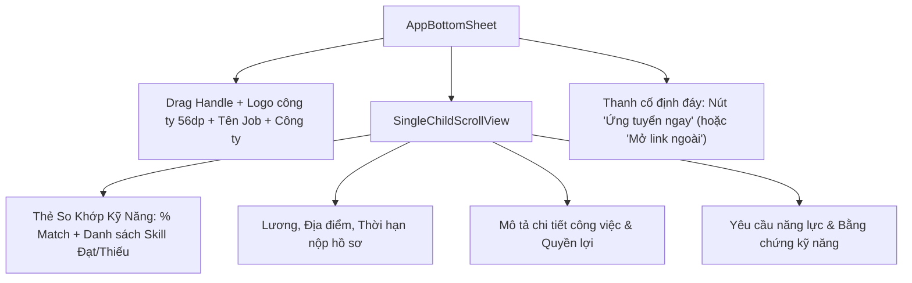

# Đặc Tả Màn Hình: M-02 Chi Tiết Việc Làm (M-02-JOB-DETAIL.md)

Lô 2 - Màn 2: Modal Bottom Sheet xem chi tiết công việc và nộp đơn ứng tuyển (`docs/SPEC.md:F-003`).

---

## 1. Mục Tiêu Người Dùng & Tác Vụ Chính
- **Mục tiêu**: Xem chi tiết mô tả công việc, quyền lợi, yêu cầu kỹ năng và nộp hồ sơ ứng tuyển trực tiếp hoặc qua liên kết ngoài của nhà tuyển dụng (`F-003`).
- **Tác vụ chính**: Đọc mô tả việc làm chi tiết; xem mức độ phù hợp kỹ năng (Match Score); chọn CV để nộp; bấm nộp đơn ứng tuyển hoặc mở link tuyển dụng bên ngoài.

---

## 2. Thay Đổi So Với Hiện Tại & Lý Do
- **Cũ (`job_detail_sheet.dart:19`)**: Giao diện modal phẳng cũ kỹ, nút nộp đơn dính sát đáy thiếu khoảng đệm an toàn; chưa làm nổi bật các kỹ năng ứng viên đã có so với yêu cầu của nhà tuyển dụng.
- **Mới**:
  - Khung Modal chuẩn Executive: Bo góc trên lớn 24dp (`radiusLarge`), thanh kéo gạt (drag handle) mờ 4dp x 36dp ở đầu.
  - Header nổi bật: Logo công ty kích thước lớn 56dp, tên vị trí kiểu chữ `TitleLarge`, huy hiệu địa điểm và loại hình công việc (`Toàn thời gian`, `Thực tập`).
  - Hộp thông tin Match Score: Banner xanh ngà hiển thị % độ khớp kỹ năng (Ví dụ: *"Phù hợp 85% - Bạn có 4/5 kỹ năng yêu cầu"*).
  - Thanh nút ứng tuyển cố định dưới đáy (Sticky Footer): Nút `AppButton` Primary "Ứng tuyển ngay" đạt chuẩn vùng chạm 48dp, có bóng đổ nhẹ.

---

## 3. Bố Cục Mới & Cây Widget Cấp Cao

---

## 4. Các Trạng Thái Giao Diện
- **Mặc định**: Hiển thị đầy đủ thông tin chi tiết và nút nộp đơn khả dụng.
- **Đang nộp hồ sơ (`applying`)**: Nút nộp hiển thị spinner xoay nhẹ, không cho bấm đúp.
- **Đã nộp đơn thành công**: Nút chuyển sang màu xám nhạt với icon tick xanh `[✓ Đã ứng tuyển]`.
- **Việc làm nộp qua link ngoài**: Nút hiển thị icon mở tab ngoài `[Nộp hồ sơ trên website công ty ↗]`.

---

## 5. Dữ Liệu & Hành Động (Gắn với ViewModel Hiện Có)
- Dữ liệu nhận vào: `JobEntity job`.
- Trạng thái liên quan: `CvProvider.cvs` (chọn CV nộp), `StudentApplicationsProvider.hasApplied(job.id)`.
- Hành động gọi usecase:
  - Bấm Nộp đơn nội bộ $\rightarrow$ Gọi API nộp CV đã chọn.
  - Bấm Nộp qua link ngoài $\rightarrow$ Gọi `url_launcher` mở `job.applyUrl`.

---

## 6. Nội Dung & Trợ Năng (l10n & A11y)
- **Chuỗi l10n**: `jobApplyButton` ("Ứng tuyển ngay"), `jobAppliedButton` ("Đã nộp đơn"), `jobMatchScoreTitle` ("Độ phù hợp hồ sơ"), `jobExternalNotice` ("Chuyển đến trang tuyển dụng ngoài").
- **A11y**: Nút đóng modal và thanh gạt drag handle có nhãn Semantics rõ ràng. Thanh nút Sticky Footer có nền màu đặc `#FFFFFF` ngăn chữ bên dưới bị đè khi cuộn.

---

## 7. Tiêu Chí Nghiệm Thu
1. Modal mở lên mượt mà bằng hoạt ảnh trượt từ đáy trong 300ms.
2. Nút ứng tuyển cố định luôn nổi trên cùng, không bị nội dung cuộn che khuất.
3. Khi bấm nộp đơn ngoài, ứng dụng mở đúng trình duyệt hệ thống mà không văng app.

