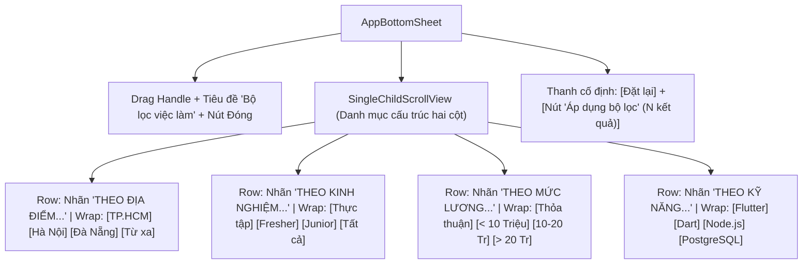

# Đặc Tả Màn Hình: M-03 Bộ Lọc Việc Làm Có Cấu Trúc (M-03-JOB-FILTER.md)

Lô 2 - Màn 3: Modal Bottom Sheet lọc công việc nâng cao theo phong cách danh mục cấu trúc Clay (`docs/SPEC.md:F-003`).

---

## 1. Mục Tiêu Người Dùng & Tác Vụ Chính
- **Mục tiêu**: Thu hẹp danh sách việc làm theo các tiêu chí chuẩn xác (Địa điểm, Kinh nghiệm, Mức lương, Kỹ năng) nhanh chóng chỉ trong vài thao tác chạm (`F-003`).
- **Tác vụ chính**: Lựa chọn tiêu chí lọc dạng chip hai cột; xóa nhanh bộ lọc; áp dụng bộ lọc và cập nhật ngay danh sách việc làm.

---

## 2. Thay Đổi So Với Hiện Tại & Lý Do
- **Cũ (`job_filter_sheet.dart:15`)**: Các ô checkbox và radio button truyền thống chiếm nhiều diện tích, khó quét bằng mắt; thiếu sự phân loại danh mục logic.
- **Mới**:
  - Áp dụng cấu trúc danh mục hai cột chuẩn Clay (như ảnh màn Search Clay): Cột trái hiển thị nhãn danh mục hoa chữ xám (`THEO ĐỊA ĐIỂM...`, `THEO VAI TRÒ...`, `THEO KỸ NĂNG...`), cột phải là lưới chip bo tròn 8dp.
  - Chip lọc tương tác: Chip chưa chọn có nền trắng viền mảnh xám `#E2E8F0`; chip đã chọn có nền xanh nhạt `#EEF2FF` viền xanh `#2952CC` chữ xanh đậm `#1E40AF`.
  - Thanh chân trang kép (Dual Footer): Nút "Thiết lập lại" dạng text/ghost và nút "Áp dụng bộ lọc" màu xanh Primary nổi bật.

---

## 3. Bố Cục Mới & Cây Widget Cấp Cao

---

## 4. Các Trạng Thái Giao Diện
- **Mặc định**: Tải trạng thái bộ lọc hiện tại từ `JobProvider.filter`.
- **Có thay đổi (Dirty)**: Nút "Đặt lại" sáng lên, nút Áp dụng hiển thị số lượng tiêu chí đã chọn.
- **Sau khi bấm Áp dụng**: Tự động đóng modal mượt mà và làm mới lưới việc làm phía sau.

---

## 5. Dữ Liệu & Hành Động (Gắn với ViewModel Hiện Có)
- Dữ liệu nhận vào: `JobFilter filter = context.watch<JobProvider>().filter`.
- Hành động gọi ViewModel:
  - Chọn chip $\rightarrow$ Cập nhật state nội bộ của Sheet.
  - Bấm Đặt lại $\rightarrow$ `jobProvider.clearFilter()`.
  - Bấm Áp dụng $\rightarrow$ `jobProvider.applyFilter(newFilter)` và đóng modal.

---

## 6. Nội Dung & Trợ Năng (l10n & A11y)
- **Chuỗi l10n**: `filterTitle` ("Bộ lọc việc làm"), `filterReset` ("Thiết lập lại"), `filterApply` ("Áp dụng bộ lọc"), `filterLocationLabel` ("THEO ĐỊA ĐIỂM..."), `filterRoleLabel` ("THEO VAI TRÒ...").
- **A11y**: Mỗi chip có `Semantics` thông báo trạng thái: "Địa điểm TP.HCM, trạng thái: đã chọn". Vùng bấm tối thiểu đạt chuẩn 48dp qua khoảng đệm trong suốt.

---

## 7. Tiêu Chí Nghiệm Thu
1. Các danh mục phân loại hai cột hiển thị cân đối trên cả màn hình nhỏ và màn hình lớn.
2. Bấm "Đặt lại" xóa sạch toàn bộ các chip đang chọn và khôi phục về trạng thái ban đầu.
3. Bộ lọc được lưu vào local preferences để không bị mất khi người dùng mở lại app.

