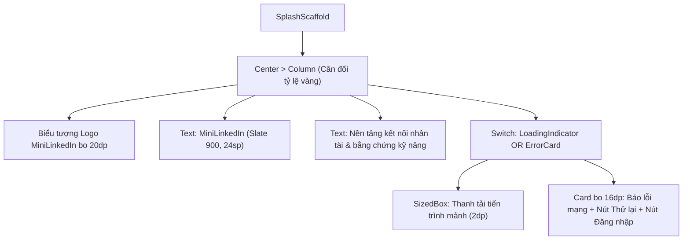

# Đặc Tả Màn Hình: S-01 Khởi Động & Xác Thực (S-01-SPLASH.md)

Lô 4 - Màn 1: Màn hình Splash khởi động và định tuyến phiên đăng nhập (`docs/SPEC.md:F-001`).

---

## 1. Mục Tiêu Người Dùng & Tác Vụ Chính
- **Mục tiêu**: Khởi tạo phiên làm việc nhanh chóng, kiểm tra token phiên đăng nhập và định tuyến mượt mà tới không gian làm việc phù hợp (`F-001`).
- **Tác vụ chính**: Tự động kiểm tra trạng thái xác thực; chuyển hướng sinh viên vào `/student-home`, nhà tuyển dụng vào `/recruiter-home`, người dùng mới vào `/login`; cung cấp nút thử lại kết nối khi mạng gián đoạn.

---

## 2. Thay Đổi So Với Hiện Tại & Lý Do
- **Cũ (`splash_screen.dart:8`)**:
  - Sử dụng màu xanh LinkedIn cũ `#0A66C2` và vòng xoay mặc định; xử lý lỗi kết nối thô sơ; thiếu nhận diện thương hiệu tinh tế.
- **Mới (Theo ngôn ngữ Executive Minimalist)**:
  - Nền tuyết Slate 50 `#F8FAFC`, logo MiniLinkedIn tối giản được đặt giữa màn hình với biểu tượng cách điệu bo tròn 20dp, đổ bóng êm ái.
  - Vòng chỉ báo tải: Thanh tiến trình mảnh viền xanh `#2952CC` nền trắng, tạo cảm giác mượt mà và cao cấp.
  - Khi gặp lỗi mạng: Card thông báo lỗi bo tròn 16dp viền mỏng xám `#E2E8F0`, nút "Thử lại kết nối" dạng pill bo 20dp xanh `#2952CC` và nút thứ cấp "Chuyển đến Đăng nhập" chữ xám Slate 600.

---

## 3. Bố Cục Mới & Cây Widget Cấp Cao


```text
┌──────────────────────────────────────────┐
│                                          │
│                 ┌──────┐                 │
│                 │ [ML] │  (Logo bo 20dp) │
│                 └──────┘                 │
│               MiniLinkedIn               │
│      Nền tảng kết nối & kỹ năng          │
│                                          │
│             [ ───●─── ]                  │ <- Loading tiến trình mảnh
│                                          │
│    (Nếu lỗi mạng: Thẻ bo 16dp báo lỗi)   │
│     [    Thử lại kết nối    ]            │
│          Chuyển đến Đăng nhập            │
│                                          │
└──────────────────────────────────────────┘
```

---

## 4. Tất Cả Trạng Thái Giao Diện
- **Đang kiểm tra token (`checking`)**: Hiển thị logo và thanh tiến trình mảnh màu xanh `#2952CC`.
- **Đã xác thực là Sinh viên**: Chuyển hướng ngay sang `/student-home` (loại bỏ màn hình Splash khỏi ngăn xếp `pushReplacementNamed`).
- **Đã xác thực là Nhà tuyển dụng**: Chuyển hướng sang `/recruiter-home`.
- **Chưa đăng nhập / Token hết hạn**: Chuyển hướng mượt mà sang `/login`.
- **Lỗi kết nối máy chủ**: Hiển thị card cảnh báo mạng, cung cấp nút "Thử lại kết nối" và nút "Chuyển đến Đăng nhập".

---

## 5. Hành Vi & Hoạt Ảnh
- Hiệu ứng xuất hiện: Logo mờ dần và hiện rõ (Fade-in) trong 400ms `Curves.easeOut`.
- Điều hướng: Chuyển trang mượt mà không nhấp nháy màn hình đen.

---

## 6. Dữ Liệu & Hợp Đồng ViewModel
- Sử dụng `AuthProvider`:
  - Trạng thái: `authProvider.status`, `authProvider.isAuthenticated`, `authProvider.isStudent`, `authProvider.errorMessage`.
  - Phương thức: `authProvider.checkAuth()`.
- Giữ nguyên hợp đồng định tuyến và kiểm tra vai trò hiện có.

---

## 7. Nội Dung & Bản Địa Hóa
- Tên app: "MiniLinkedIn"
- Phụ đề: "Nền tảng kết nối tài năng & kỹ năng minh chứng"
- Nút thử lại: "Thử lại kết nối"
- Nút đăng nhập: "Chuyển đến Đăng nhập"

---

## 8. Trợ Năng & Kiểm Thử
- Tương phản văn bản và nút bấm đạt chuẩn WCAG AA ($\ge 4.5:1$).
- Test keys: `ValueKey('splash_screen')`, `ValueKey('splash_retry_btn')`, `ValueKey('splash_login_btn')`.

---

## 9. Tiêu Chí Nghiệm Thu
1. Màn hình khởi động thanh lịch, logo hiển thị rõ ràng, không giật màn hình.
2. Tự động chuyển hướng chính xác theo vai trò người dùng trong $\le 1.5$ giây.
3. Khi mất kết nối mạng, hiển thị đầy đủ tùy chọn thử lại hoặc đăng nhập thủ công.

