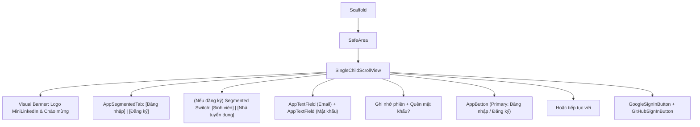

# Đặc Tả Màn Hình: S-02 & S-03 Xác Thực & Chào Mừng (S-02-AUTH.md)

Màn thí điểm 1: Đăng nhập & Đăng ký tài khoản (Phỏng theo mẫu `Premium Auth` & `Onboarding Screen` từ 21st.dev).

---

## 1. Mục Tiêu Người Dùng & Tác Vụ Chính
- **Mục tiêu**: Đăng nhập nhanh chóng, an toàn bằng Email/Mật khẩu hoặc Google/GitHub SSO; đăng ký tài khoản mới phân định rõ vai trò Sinh viên hoặc Nhà tuyển dụng (`docs/SPEC.md:F-001`).
- **Tác vụ chính**: Chuyển đổi linh hoạt giữa Login / Register qua Segmented Tab; nhập email & mật khẩu có kiểm tra lỗi trực tiếp; đăng nhập 1 chạm với SSO; ghi nhớ phiên đăng nhập.

---

## 2. Thay Đổi So Với Hiện Tại & Lý Do
- **Cũ (`login_screen.dart:18`)**: Giao diện form đơn điệu, chia tách 2 trang Login và Register riêng biệt khiến người dùng phải chuyển trang nhiều lần; màu xanh LinkedIn cũ `#0A66C2`; thông báo lỗi đẩy ra SnackBar rời rạc.
- **Mới**:
  - Tích hợp `AppSegmentedTab` dạng pill (`Đăng nhập` | `Đăng ký`) ngay trên cùng form, chuyển đổi tức thì không cần reload route.
  - Ô nhập liệu bo 12dp có icon đầu dòng (`mail`, `lock`) và nút mắt ẩn/hiện mật khẩu.
  - Báo lỗi đỏ inline (`errorText`) ngay dưới ô input khi gõ sai định dạng (giải quyết triệt để lỗi P0-1).
  - Nút đăng nhập Google & GitHub hiển thị dạng outline sang trọng, đạt chuẩn vùng chạm 48dp.

---

## 3. Bố Cục Mới & Cây Widget Cấp Cao

---

## 4. Các Trạng Thái Giao Diện
- **Mặc định**: Hiển thị form trống, nút Submit khả dụng khi cả hai ô có nội dung.
- **Đang tải (`loading`)**: Nút submit hiển thị `CircularProgressIndicator` mini màu trắng; các ô input và nút SSO bị vô hiệu hóa (`enabled: false`).
- **Lỗi xác thực (`error`)**: Khung thông báo lỗi đỏ nhạt bo 8dp xuất hiện phía trên nút submit; ô input viền đỏ và hiển thị `errorText` chi tiết.
- **Mất mạng / Ngoại tuyến**: Thông báo banner vàng nhạt: *"Không có kết nối mạng, vui lòng kiểm tra lại"*, giữ nguyên thông tin đã điền.
- **Thành công**: Chuyển tiếp mượt mà vào `/student-home` hoặc `/recruiter-home`.

---

## 5. Dữ Liệu & Hành Động (Gắn với ViewModel Hiện Có)
- Trạng thái lắng nghe từ `AuthProvider` (`features/auth/.../auth_provider.dart:28`):
  - `authProvider.isLoading` $\rightarrow$ Trạng thái loading của nút bấm và input.
  - `authProvider.errorMessage` $\rightarrow$ Thông báo lỗi hiển thị trên form.
- Hành động gọi ViewModel:
  - Bấm Đăng nhập $\rightarrow$ `authProvider.login(email, password)`.
  - Bấm Đăng nhập Google $\rightarrow$ `authProvider.loginWithGoogle()`.
  - Bấm Đăng nhập GitHub $\rightarrow$ `authProvider.loginWithGitHub()`.
  - Bấm Đăng ký $\rightarrow$ `authProvider.register(email, password, role)`.

---

## 6. Nội Dung & Trợ Năng (l10n & A11y)
- **Chuỗi đề xuất bổ sung l10n**: `authWelcomeBack` ("Chào mừng trở lại"), `authSignInSubtitle` ("Đăng nhập vào tài khoản của bạn"), `authEmailLabel` ("Địa chỉ Email"), `authPasswordLabel` ("Mật khẩu").
- **A11y**: Kích thước mọi nút bấm và ô nhập liệu $\ge 48\text{dp}$. `Semantics` gán nhãn rõ ràng cho nút ẩn/hiện mật khẩu ("Hiện mật khẩu" / "Ẩn mật khẩu").

---

## 7. Tiêu Chí Nghiệm Thu
1. Chuyển đổi tab Đăng nhập / Đăng ký mượt mà trong 200ms không giật lag.
2. Khi nhập email sai cấu trúc, thông báo lỗi đỏ hiện ngay dưới ô email trước khi bấm submit.
3. Không vỡ layout trên màn hình nhỏ từ 360dp bề ngang.

