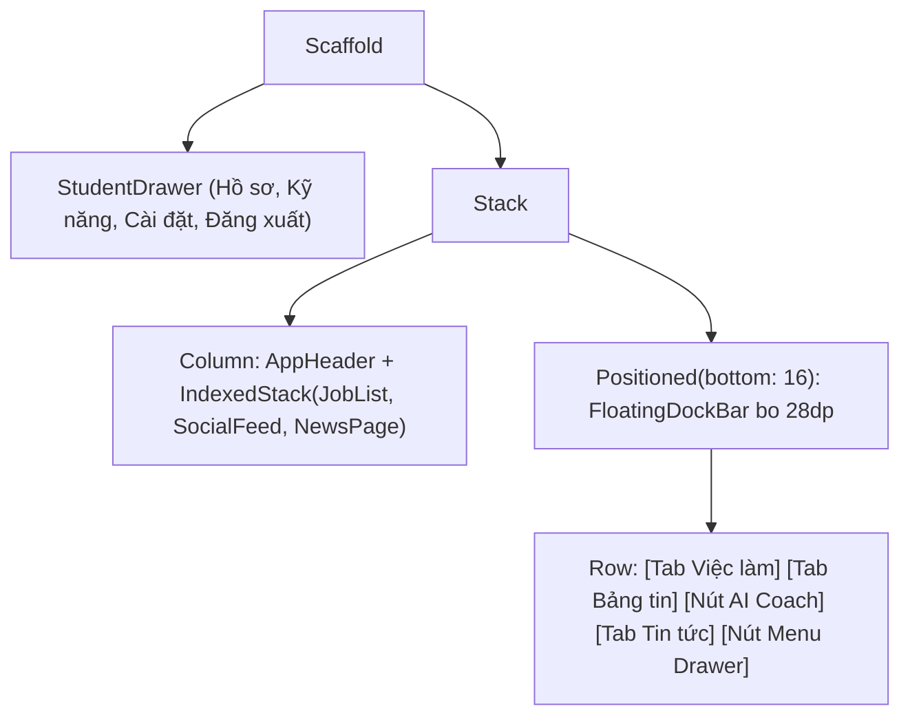

# Đặc Tả Màn Hình: S-04 Khung Điều Hướng Sinh Viên (S-04-STUDENT-HOME.md)

Lô 3 - Màn 1: Khung Shell điều hướng chính sinh viên (`docs/SPEC.md:F-002`).

---

## 1. Mục Tiêu Người Dùng & Tác Vụ Chính
- **Mục tiêu**: Điều hướng liền mạch giữa các không gian chức năng chính (Việc làm, Bảng tin mạng xã hội, Tin tức công nghệ, Trợ lý AI, Menu cá nhân) (`F-002`).
- **Tác vụ chính**: Chuyển đổi tab nhanh bằng 1 chạm; kích hoạt Trợ lý kỹ năng AI bất kỳ lúc nào; mở Drawer tài khoản & hồ sơ; tự động nhớ tab đã chọn gần nhất.

---

## 2. Thay Đổi So Với Hiện Tại & Lý Do
- **Cũ (`student_bottom_bar.dart:15`, `student_home_screen.dart:88`)**:
  - `NavigationBar` chuẩn Material 3 đáy phẳng chiếm diện tích lớn, không tối ưu cho thao tác một tay.
  - Nút FAB nổi Trợ lý kỹ năng nằm đè lên góc phải dưới cùng, dễ che khuất nội dung danh sách và gây xung đột với thanh cuộn.
- **Mới (Theo ảnh Clay Home)**:
  - Thanh điều hướng nổi `FloatingDockBar` bo tròn 28dp kính mờ (`BackdropFilter` sigma 16), đổ bóng mềm `0 8px 30px rgba(0,0,0,0.08)`, viền mỏng 1px `#E2E8F0`.
  - Nút Trợ lý AI được tích hợp trực tiếp vào vị trí trung tâm của Dock với biểu tượng `Icons.auto_awesome` nền xanh `#2952CC` chữ trắng, tạo điểm nhấn đồng nhất thay vì FAB lệch góc.
  - Tự động bổ sung khoảng đệm đáy `bottomPadding: 88dp` cho mọi nội dung cuộn bên trong `IndexedStack` để nội dung không bị Dock che khuất.

---

## 3. Bố Cục Mới & Cây Widget Cấp Cao


```text
┌──────────────────────────────────────────┐
│ [☰ Avatar]   MiniLinkedIn     [🔔 Thông báo]│
├──────────────────────────────────────────┤
│                                          │
│         NỘI DUNG TAB ĐANG CHỌN           │
│     (Việc làm / Mạng xã hội / Tin tức)    │
│                                          │
│  (Khoảng đệm đáy 88dp bảo vệ nội dung)    │
│                                          │
│    ┌────────────────────────────────┐    │
│    │ [💼]    [👥]    [✦ AI]   [📰] [☰] │    │ <- FloatingDockBar (bo 28dp)
│    └────────────────────────────────┘    │
└──────────────────────────────────────────┘
```

---

## 4. Tất Cả Trạng Thái Giao Diện
- **Khởi tạo**: Đọc `_preferences.getSelectedTab()`, hiển thị tab đã chọn hoặc mặc định Tab 0 (Việc làm).
- **Chuyển tab mượt**: Hiệu ứng chuyển động nhẹ nhàng, đổi icon trạng thái active (xanh `#2952CC`, fill).
- **Chạm nút AI Coach**: Hiển thị BottomSheet `openCoachSheet(context)`.
- **Chạm nút Menu Drawer**: Gọi `Scaffold.of(context).openDrawer()`.

---

## 5. Hành Vi & Hoạt Ảnh
- Chạm vào tab: Kích hoạt `HapticFeedback.selectionClick()`, icon tab co giãn nhẹ 150ms `Curves.easeInOut`.
- Cuộn danh sách: Dock vẫn cố định nhẹ nhàng tại vị trí lơ lửng, tạo chiều sâu thị giác chuẩn Clay.

---

## 6. Dữ Liệu & Hợp Đồng ViewModel
- Tab index: Quản lý bằng `_selectedIndex` và lưu trữ qua `IAppPreferences.saveSelectedTab(index)`.
- Drawer actions: Gọi `AuthProvider.logout()`, `Navigator.pushNamed('/profile')`, `Navigator.pushNamed('/skills')`.
- Không yêu cầu sửa đổi ViewModel backend hay Repository.

---

## 7. Nội Dung & Bản Địa Hóa
- Tab 0: `l10n.jobsTab` ("Việc làm")
- Tab 1: `l10n.socialTab` ("Mạng xã hội")
- AI Action: "Trợ lý AI"
- Tab 2: `l10n.newsTab` ("Tin tức")
- Drawer Menu: "Menu"

---

## 8. Trợ Năng & Kiểm Thử
- Mọi nút chạm trong Dock có kích thước tối thiểu $48 \times 48\text{dp}$.
- Nhãn `Semantics`: `Semantics(label: 'Chuyển sang tab Việc làm', selected: isSelected)`.
- Test keys: `ValueKey('student_home_dock')`, `ValueKey('dock_tab_0')`, `ValueKey('dock_tab_1')`, `ValueKey('dock_ai_btn')`, `ValueKey('dock_tab_2')`.

---

## 9. Tiêu Chí Nghiệm Thu
1. Dock bar hiển thị bo 28dp lơ lửng cách đáy màn hình 16dp, kính mờ rõ nét.
2. Nút AI Coach ở giữa mở đúng `CoachSheet`.
3. Chuyển tab giữ nguyên trạng thái cuộn của từng trang nhờ `IndexedStack`.
4. Danh sách ở cả 3 tab cuộn xuống cuối không bị thanh Dock che lấp.

