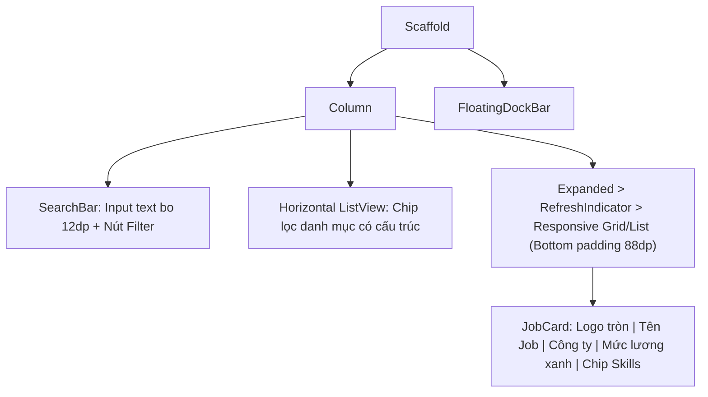

# Đặc Tả Màn Hình: S-05 Danh Sách Việc Làm (S-05-JOBS.md)

Lô 2 - Màn 1: Trang Danh sách việc làm sinh viên (`docs/SPEC.md:F-003`).

---

## 1. Mục Tiêu Người Dùng & Tác Vụ Chính
- **Mục tiêu**: Giúp sinh viên nhanh chóng tìm kiếm, lọc và khám phá các cơ hội thực tập, việc làm công nghệ phù hợp với bộ kỹ năng đã có (`F-003`).
- **Tác vụ chính**: Tìm kiếm việc làm theo từ khóa; mở bộ lọc có cấu trúc; xem danh sách việc làm dạng thẻ card; xem mức lương, địa điểm, kỹ năng yêu cầu; chạm để mở modal chi tiết hoặc ứng tuyển nhanh.

---

## 2. Thay Đổi So Với Hiện Tại & Lý Do
- **Cũ (`job_list_screen.dart:16`)**: Khung tìm kiếm đơn giản, chip lọc thiếu phân loại danh mục; hardcode 100% tiếng Việt trong widget (lỗi P0-2); màu lương và nút chưa đồng bộ token mới.
- **Mới**:
  - Khung tìm kiếm chuẩn Executive Minimalist: Nền trắng, viền mảnh 1px `#E2E8F0`, icon kính lúp và nút mở bộ lọc bo 12dp.
  - Thanh danh mục gợi ý trượt ngang dạng cấu trúc (Clay style): `[Vị trí: Tất cả]`, `[Địa điểm: TP.HCM, Hà Nội]`, `[Mức lương: Thỏa thuận, Có lương]`.
  - Thẻ `JobCard` bo 16dp: Logo công ty tròn 44dp, tiêu đề `TitleMedium`, tag lương xanh `#10B981` nổi bật, chip kỹ năng yêu cầu kèm chỉ số match kỹ năng (`MatchScoreChip`).
  - Hỗ trợ responsive: 1 cột cho Mobile (<600dp), 2 cột cho Tablet (<900dp), 3 cột cho Web (>=900dp, max-width 1200dp).
  - Khoảng đệm cuộn đáy `bottomPadding: 88dp` tương thích Floating Dock.

---

## 3. Bố Cục Mới & Cây Widget Cấp Cao

---

## 4. Các Trạng Thái Giao Diện
- **Mặc định / Có dữ liệu**: Lưới danh sách việc làm hiển thị mượt mà.
- **Đang tải (`loading`)**: Hiển thị lưới khung xương `AppSkeleton` nhấp nháy êm dịu, giữ nguyên khung tìm kiếm trên đầu.
- **Không tìm thấy kết quả (Rỗng)**: `EmptyStateView` hiển thị icon kính lúp tìm kiếm và nút *"Xóa bộ lọc để xem tất cả"* (loại bỏ luồng cụt).
- **Lỗi tải dữ liệu**: Thẻ thông báo lỗi kèm nút *"Thử lại"* gọi usecase `jobProvider.loadJobs()`.

---

## 5. Dữ Liệu & Hành Động (Gắn với ViewModel Hiện Có)
- Trạng thái từ `JobProvider` (`features/jobs/.../job_provider.dart:22`):
  - `jobProvider.jobs` $\rightarrow$ Danh sách việc làm `List<JobEntity>`.
  - `jobProvider.isLoading` $\rightarrow$ Trạng thái tải.
  - `jobProvider.filter` $\rightarrow$ Bộ lọc đang áp dụng (`JobFilter`).
- Hành động gọi ViewModel:
  - Nhập tìm kiếm $\rightarrow$ `jobProvider.search(query)`.
  - Bấm chọn chip lọc $\rightarrow$ `jobProvider.applyFilter(filter)`.
  - Bấm thẻ việc làm $\rightarrow$ Mở `JobDetailSheet(job)`.

---

## 6. Nội Dung & Trợ Năng (l10n & A11y)
- **Chuỗi đề xuất bổ sung l10n**: `jobsSearchPlaceholder` ("Tìm kiếm công việc, kỹ năng, công ty..."), `jobsFilterButton` ("Bộ lọc"), `jobsEmptyTitle` ("Không tìm thấy công việc phù hợp"), `jobsClearFilter` ("Xóa bộ lọc").
- **A11y**: Mỗi thẻ việc làm gán `Semantics` đọc đầy đủ: "Công việc: [Tên], Công ty: [Tên], Mức lương: [Lương]". Vùng bấm thẻ $\ge 48\text{dp}$.

---

## 7. Tiêu Chí Nghiệm Thu
1. Lưới việc làm hiển thị đúng 1 cột trên Mobile và 2-3 cột trên màn hình rộng không bị lỗi tràn pixel.
2. Nút xóa bộ lọc đưa danh sách trở về trạng thái toàn bộ việc làm khả dụng.
3. Khi cuộn xuống hết danh sách, thẻ cuối cùng không bị che khuất bởi Floating Dock.

