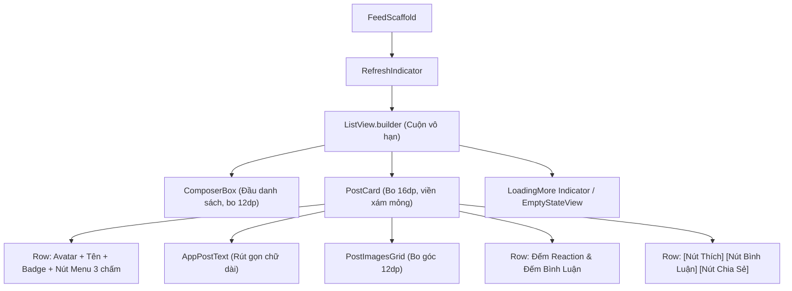

# Đặc Tả Màn Hình: S-06 Bảng Tin Mạng Xã Hội (S-06-SOCIAL-FEED.md)

Lô 3 - Màn 2: Dòng thời gian bài viết kết nối cộng đồng sinh viên (`docs/SPEC.md:F-004`).

---

## 1. Mục Tiêu Người Dùng & Tác Vụ Chính
- **Mục tiêu**: Cập nhật thông tin tuyển dụng, kinh nghiệm phỏng vấn, trao đổi kỹ thuật và chia sẻ dự án cá nhân từ cộng đồng lập trình viên (`F-004`).
- **Tác vụ chính**: Lướt xem bài viết cuộn vô hạn; tương tác cảm xúc (6 loại reaction); bình luận và phản hồi bình luận; chia sẻ bài viết; mở màn hình tạo bài viết mới.

---

## 2. Thay Đổi So Với Hiện Tại & Lý Do
- **Cũ (`social_feed_screen.dart:15`, `post_card.dart:20`)**:
  - Nền xám Facebook `#F0F2F5` tạo cảm giác lỗi thời, phân cách giữa các bài viết thô cứng.
  - Ô soạn thảo `ComposerBox` đơn điệu, thanh tương tác chiếm diện tích và các icon reaction thiếu tính thanh lịch.
- **Mới (Theo ảnh Clay Home Feed & Executive Minimalist)**:
  - Nền trang Slate 50 `#F8FAFC`, thẻ `PostCard` nền trắng tinh tuyết `#FFFFFF` bo 16dp, viền mỏng 1px `#E2E8F0`, đổ bóng cực nhẹ `0 1px 3px rgba(0,0,0,0.05)`, khoảng cách giữa các bài viết 12dp.
  - Ô `ComposerBox` ở đầu danh sách bo 12dp: Avatar người dùng bên trái, ô nhập dạng pill với thông điệp khích lệ: "Chia sẻ kinh nghiệm lập trình hoặc câu hỏi của bạn...", kèm icon tải ảnh nhanh.
  - Thẻ `PostCard`: Header gồm Avatar tác giả tròn 40dp, tên tác giả Slate 900 semibold, nhãn vai trò mờ, thời gian đăng bài màu xám Slate 500; Lưới ảnh bo tròn 12dp; Hàng nút tương tác tối giản với số lượt like/bình luận hiển thị tinh tế.
  - Menu 6 loại cảm xúc (Like, Love, Haha, Wow, Sad, Angry) dạng floating bubble bo tròn 24dp khi nhấn giữ nút Thích.
  - Thêm khoảng đệm đáy `bottomPadding: 88dp` tránh bị `FloatingDockBar` che lấp.

---

## 3. Bố Cục Mới & Cây Widget Cấp Cao


```text
┌──────────────────────────────────────────┐
│ [Avatar] Bạn đang nghĩ gì?          [📷] │ <- ComposerBox (bo 12dp)
├──────────────────────────────────────────┤
│ ┌──────────────────────────────────────┐ │
│ │ [Avatar] Nguyễn Văn A  • 2 giờ trước │ │
│ │ Sinh viên ĐH Bách Khoa               │ │
│ │                                      │ │
│ │ Mình vừa hoàn thành dự án Flutter    │ │
│ │ tích hợp Clean Architecture...       │ │
│ │                                      │ │
│ │ ┌──────────────────────────────────┐ │ │
│ │ │        [Ảnh minh họa bo 12dp]    │ │ │
│ │ └──────────────────────────────────┘ │ │
│ │                                      │ │
│ │ 👍 24 lượt thích        8 bình luận  │ │
│ │ ──────────────────────────────────── │ │
│ │ [👍 Thích]    [💬 Bình luận]   [↗ Chia]│ │
│ └──────────────────────────────────────┘ │
│ (Đệm cuộn đáy 88dp bảo vệ nội dung)      │
└──────────────────────────────────────────┘
```

---

## 4. Tất Cả Trạng Thái Giao Diện
- **Đang tải ban đầu**: Hiển thị 3 khung xương `FeedSkeleton` bo tròn 16dp hiệu ứng shimmer.
- **Bảng tin rỗng**: `AppEmptyState` với icon `Icons.forum_outlined`, nhãn "Chưa có bài viết nào", nút "Tạo bài viết đầu tiên".
- **Lỗi mạng/tải**: `AppEmptyState` với icon `Icons.cloud_off_outlined`, nhãn "Không thể tải bảng tin", nút "Thử lại".
- **Đang tải thêm ở cuối danh sách**: Vòng xoay nhỏ $24\text{dp}$ xanh Slate ở đáy.
- **Kéo để làm mới**: `RefreshIndicator` màu chủ đạo xanh `#2952CC`.

---

## 5. Hành Vi & Hoạt Ảnh
- Nhấn giữ nút Thích: Hiển thị thanh chọn 6 cảm xúc nổi lên trong 150ms với hiệu ứng nảy nhẹ.
- Chạm vào bài viết: Mở chi tiết bình luận dạng `CommentsSheet` bo trên 24dp.
- Chạm vào ảnh: Mở `ImageViewerScreen` toàn màn hình với cử chỉ zoom 2 ngón tay.

---

## 6. Dữ Liệu & Hợp Đồng ViewModel
- Sử dụng `SocialFeedProvider`:
  - Dữ liệu: `feed.posts`, `feed.status`, `feed.loadingMore`, `feed.error`.
  - Phương thức: `feed.loadInitial()`, `feed.loadMore()`, `feed.refresh()`, `feed.toggleReaction(postId, kind)`.
- Không thay đổi ViewModel backend, không thêm endpoint.

---

## 7. Nội Dung & Bản Địa Hóa
- Tiêu đề rỗng: `SocialStrings.feedEmptyTitle` ("Chưa có bài viết nào")
- Mô tả rỗng: `SocialStrings.feedEmptyMessage` ("Hãy là người đầu tiên chia sẻ...")
- Nút thử lại: `SocialStrings.retry` ("Thử lại")
- Các nút hành động: "Thích", "Bình luận", "Chia sẻ"

---

## 8. Trợ Năng & Kiểm Thử
- Các nút hành động đạt vùng bấm $\ge 48\text{dp}$.
- Text contrast $\ge 4.5:1$ trên nền trắng.
- Test keys: `ValueKey('feed_composer')`, `ValueKey('post_card_<id>')`, `ValueKey('btn_like_<id>')`, `ValueKey('btn_comment_<id>')`.

---

## 9. Tiêu Chí Nghiệm Thu
1. Thẻ bài viết hiển thị phẳng thanh lịch, bo góc 16dp viền xám mảnh, khoảng cách 12dp.
2. Composer box dẫn thẳng vào màn tạo bài viết `CreatePostScreen`.
3. Nhấn giữ hiển thị đầy đủ 6 cảm xúc, chọn cảm xúc cập nhật ngay lập tức.
4. Cuộn mượt mà với 60fps và không bị che khuất bởi thanh Dock ở cuối trang.

