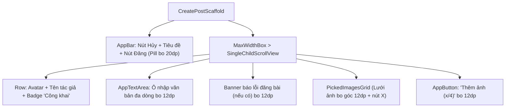

# Đặc Tả Màn Hình: S-07 Soạn & Đăng Bài Viết (S-07-CREATE-POST.md)

Lô 3 - Màn 3: Màn hình tạo mới hoặc chỉnh sửa bài viết cộng đồng (`docs/SPEC.md:F-004`).

---

## 1. Mục Tiêu Người Dùng & Tác Vụ Chính
- **Mục tiêu**: Soạn thảo và chia sẻ bài viết mới kèm hình ảnh minh họa tới cộng đồng sinh viên và nhà tuyển dụng (`F-004`).
- **Tác vụ chính**: Nhập nội dung bài viết; chọn tối đa 4 hình ảnh từ thư viện; xóa bớt ảnh đã chọn; đăng bài hoặc lưu chỉnh sửa bài viết cũ.

---

## 2. Thay Đổi So Với Hiện Tại & Lý Do
- **Cũ (`create_post_screen.dart:16`)**:
  - Giao diện biên tập đơn giản, các thành phần xếp chồng thiếu phân cấp; nút "Đăng" ở AppBar thiếu điểm nhấn; thông báo lỗi đăng bài dạng chữ đỏ thô.
- **Mới (Theo phong cách Executive Minimalist)**:
  - AppBar hiện đại: Nút Đóng `Icons.close` bên trái, tiêu đề trung tâm "Tạo bài viết", nút "Đăng" bên phải thiết kế dạng pill bo tròn 20dp xanh `#2952CC` chữ trắng nổi bật (tự động vô hiệu hóa nếu nội dung rỗng).
  - Khối thông tin tác giả: Avatar tròn 44dp, tên tác giả in đậm và huy hiệu phạm vi "Công khai trong mạng lưới" bo 12dp màu Slate 100 `#F1F5F9`.
  - Khung soạn thảo `AppTextArea`: Không viền gắt, chữ 16sp Slate 900 dễ đọc, tự động co giãn theo chiều cao, hỗ trợ cuộn mượt khi văn bản dài.
  - Lưới ảnh đã chọn `PickedImagesGrid`: Các ô ảnh bo tròn 12dp, nút "X" xóa ảnh nhỏ dạng tròn kính mờ góc trên phải của mỗi ảnh.
  - Thanh công cụ đính kèm: Nút "Thêm hình ảnh" bo 12dp kèm chỉ số số lượng ảnh đã chọn `(x/4)`.
  - Xử lý trạng thái đang gửi: Nút "Đăng" chuyển sang hiển thị vòng quay `CircularProgressIndicator` trắng 16dp, khóa tương tác toàn màn hình để tránh gửi trùng lặp.

---

## 3. Bố Cục Mới & Cây Widget Cấp Cao


```text
┌──────────────────────────────────────────┐
│ [✕ Hủy]        Tạo bài viết     [ Đăng ] │ <- Nút Đăng pill xanh bo 20dp
├──────────────────────────────────────────┤
│ [Avatar]  Nguyễn Văn A                   │
│           [🌐 Công khai trong mạng lưới]  │
│                                          │
│ Bạn muốn chia sẻ điều gì hôm nay?        │
│ (Văn bản soạn thảo mở rộng tự do...)     │
│                                          │
│ ┌──────────────┐  ┌──────────────┐       │
│ │ [Ảnh 1]  [✕] │  │ [Ảnh 2]  [✕] │       │ <- Lưới ảnh bo 12dp
│ └──────────────┘  └──────────────┘       │
│                                          │
│ [ 📷 Thêm hình ảnh (2/4)               ] │ <- Nút đính kèm ảnh bo 12dp
└──────────────────────────────────────────┘
```

---

## 4. Tất Cả Trạng Thái Giao Diện
- **Mặc định (Chưa nhập chữ & ảnh)**: Nút "Đăng" ở trạng thái disabled mờ 40%.
- **Đang nhập**: Nút "Đăng" sáng màu xanh `#2952CC`, cho phép gửi.
- **Đang tải ảnh từ thiết bị**: Hiển thị thanh tiến trình nhỏ tại vị trí ảnh.
- **Đang đăng bài (`busy`)**: Nút "Đăng" đổi thành vòng xoay trắng $16\text{dp}$, ô nhập và nút chọn ảnh bị khóa.
- **Lỗi khi đăng**: Hiển thị `ErrorBanner` viền đỏ nhạt bo 12dp với thông báo lỗi cụ thể từ máy chủ.
- **Chế độ sửa bài (`editing != null`)**: Tiêu đề "Chỉnh sửa bài viết", nội dung cũ được nạp sẵn, ẩn chức năng đính kèm ảnh (theo quy định nghiệp vụ hiện có).

---

## 5. Hành Vi & Hoạt Ảnh
- Mở bàn phím: Màn hình tự động đẩy nội dung lên tránh che khuất ô nhập văn bản.
- Chạm nút "X" trên ảnh: Ảnh co nhỏ và biến mất trong 150ms `Curves.easeOut`.
- Đăng bài thành công: Đóng màn hình với hiệu ứng trượt xuống `Navigator.pop(context)`.

---

## 6. Dữ Liệu & Hợp Đồng ViewModel
- Sử dụng `SocialFeedProvider`:
  - Phương thức tạo mới: `feed.createPost(content, images)`.
  - Phương thức cập nhật: `feed.updatePost(postId, content)`.
  - Trạng thái bận: `feed.creating`.
  - Báo lỗi: `feed.createError`.
- Không thay đổi ViewModel backend, không thêm hàm mới.

---

## 7. Nội Dung & Bản Địa Hóa
- Nút hủy: `SocialStrings.cancel` ("Hủy")
- Nút đăng: `SocialStrings.postAction` ("Đăng")
- Placeholder ô nhập: `SocialStrings.createHint` ("Chia sẻ kinh nghiệm...")
- Nút thêm ảnh: `SocialStrings.addPhotos` ("Thêm hình ảnh")
- Thông báo lỗi ảnh: `SocialStrings.imageReadError` ("Không thể đọc tệp ảnh")

---

## 8. Trợ Năng & Kiểm Thử
- Đảm bảo vùng bấm nút Hủy và nút Đăng $\ge 48\text{dp}$.
- Cung cấp Semantics: `Semantics(label: 'Nút đăng bài viết', button: true, enabled: canPost)`.
- Test keys: `ValueKey('create_post_btn_submit')`, `ValueKey('create_post_input')`, `ValueKey('create_post_btn_add_images')`.

---

## 9. Tiêu Chí Nghiệm Thu
1. Nút "Đăng" chỉ kích hoạt khi có ít nhất chữ hoặc 1 hình ảnh.
2. Cho phép chọn tối đa 4 hình ảnh, xóa từng ảnh mượt mà.
3. Khi đang gửi bài, nút chuyển sang loading và toàn bộ trường nhập bị vô hiệu hóa.
4. Đăng thành công tự động quay về bảng tin và bảng tin hiển thị bài viết mới ở trên cùng.

