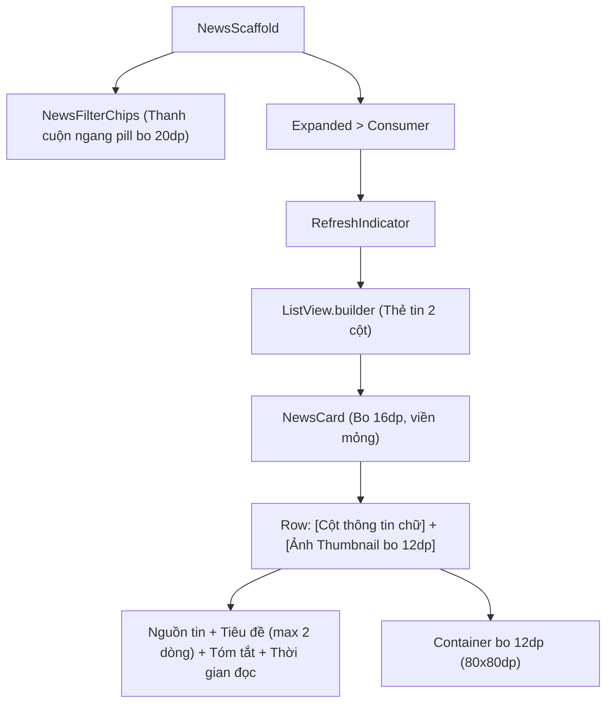

# Đặc Tả Màn Hình: S-08 Tin Tức Công Nghệ & AI (S-08-NEWS.md)

Lô 3 - Màn 4: Trang tổng hợp tin tức công nghệ và xu hướng ngành (`docs/SPEC.md:F-005`).

---

## 1. Mục Tiêu Người Dùng & Tác Vụ Chính
- **Mục tiêu**: Đón đầu các xu hướng công nghệ mới, bản phát hành framework và kiến thức phỏng vấn lập trình viên chất lượng cao (`F-005`).
- **Tác vụ chính**: Lọc tin tức theo danh mục chuyên môn; đọc lướt tiêu đề và tóm tắt bài viết; mở xem chi tiết bài báo gốc; làm mới tin tức mới nhất.

---

## 2. Thay Đổi So Với Hiện Tại & Lý Do
- **Cũ (`news_page.dart:15`, `news_card.dart:18`)**:
  - Các chip lọc thô cứng, bố cục thẻ tin xếp chồng thẳng đứng chiếm nhiều diện tích cuộn; thiếu chỉ số thời gian đọc ước tính; trạng thái rỗng chưa gợi ý đổi tab.
- **Mới (Theo ảnh Clay Home & Executive Minimalist)**:
  - Thanh danh mục cuộn ngang với các chip dạng pill bo tròn 20dp như thanh tab Clay (`Tất cả`, `Trí tuệ nhân tạo`, `Lập trình Di động`, `Điện toán Đám mây`, `Kỹ năng mềm`). Chip đang chọn có nền xanh nhạt `#EEF2FF` viền xanh `#2952CC` chữ xanh đậm `#1E40AF`.
  - Thẻ `NewsCard` thiết kế 2 cột thanh lịch bo tròn 16dp, viền mảnh 1px `#E2E8F0`, đổ bóng cực nhẹ `0 1px 3px rgba(0,0,0,0.05)`:
    - Cột trái: Tên nguồn tin viết hoa nhỏ xám Slate 500, Tiêu đề bài viết đậm Slate 900 (tối đa 2 dòng), Tóm tắt nội dung 1-2 dòng, Hàng thông tin thời gian đăng + ước tính thời gian đọc ("VnExpress • 4 phút đọc").
    - Cột phải: Ảnh thumbnail bo tròn 12dp ($80 \times 80\text{dp}$) có hiệu ứng bo góc mềm và fallback khi ảnh lỗi mạng.
  - Tự động bổ sung khoảng đệm đáy `bottomPadding: 88dp` khi `embedded == true` để không bị `FloatingDockBar` che lấp.

---

## 3. Bố Cục Mới & Cây Widget Cấp Cao


```text
┌──────────────────────────────────────────┐
│ (● Tất cả) ( Trí tuệ AI ) ( Mobile ) ( Cloud )│ <- Filter Chips pill bo 20dp
├──────────────────────────────────────────┤
│ ┌──────────────────────────────────────┐ │
│ │ TECHCRUNCH • 5 PHÚT ĐỌC              │ │
│ │ Google công bố mô hình Gemini 2.0    │ │ ┌──────────┐
│ │ đột phá mới cho lập trình viên...    │ │ │ [Ảnh tin]│ (80x80dp
│ │ Hôm nay • 1.2k lượt xem              │ │ └──────────┘  bo 12dp)
│ └──────────────────────────────────────┘ │
│ ┌──────────────────────────────────────┐ │
│ │ FLUTTER DEV • 3 PHÚT ĐỌC             │ │
│ │ Hướng dẫn tối ưu hóa hiệu năng       │ │ ┌──────────┐
│ │ bộ nhớ trong ứng dụng Flutter...     │ │ │ [Ảnh tin]│
│ │ Hôm qua • 850 lượt xem               │ │ └──────────┘
│ └──────────────────────────────────────┘ │
│ (Đệm cuộn đáy 88dp bảo vệ nội dung)      │
└──────────────────────────────────────────┘
```

---

## 4. Tất Cả Trạng Thái Giao Diện
- **Đang tải ban đầu**: Hiển thị 4 thẻ tin shimmer skeleton 2 cột.
- **Rỗng theo danh mục**: `AppEmptyState` với icon `Icons.article_outlined`, thông báo: "Không có tin tức nào trong danh mục này", nút "Xem tất cả tin tức".
- **Lỗi tải tin**: `AppEmptyState` với icon `Icons.cloud_off_outlined`, thông báo lỗi từ server, nút "Thử lại".
- **Kéo để làm mới**: `RefreshIndicator` màu xanh `#2952CC`.

---

## 5. Hành Vi & Hoạt Ảnh
- Chạm vào chip lọc: Danh sách tự động cuộn về đầu và nạp tin tức danh mục mới.
- Chạm vào thẻ tin: Mở trình duyệt in-app mở bài viết gốc với hiệu ứng mở trang mượt.

---

## 6. Dữ Liệu & Hợp Đồng ViewModel
- Sử dụng `NewsProvider`:
  - Dữ liệu: `provider.articles`, `provider.isLoading`, `provider.error`, `provider.selectedCategory`.
  - Phương thức: `provider.loadNews()`, `provider.setCategory(category)`.
- Không thay đổi ViewModel backend, không thêm hàm ngoài hợp đồng hiện có.

---

## 7. Nội Dung & Bản Địa Hóa
- Tiêu đề AppBar (chế độ độc lập): "Tin công nghệ & AI"
- Nút thử lại: "Thử lại"
- Thông báo rỗng: "Không có tin tức nào trong danh mục này"
- Đơn vị đọc: "phút đọc"

---

## 8. Trợ Năng & Kiểm Thử
- Tỷ lệ tương phản tiêu đề $\ge 4.5:1$ chuẩn WCAG AA.
- Cung cấp Semantics đọc đầy đủ tiêu đề và nguồn tin cho người dùng khiếm thị.
- Test keys: `ValueKey('news_filter_chips')`, `ValueKey('news_card_<index>')`, `ValueKey('btn_news_retry')`.

---

## 9. Tiêu Chí Nghiệm Thu
1. Thẻ tin 2 cột cân đối, bo 16dp, ảnh thumbnail bo 12dp sắc nét.
2. Các chip danh mục cuộn ngang mượt mà, chuyển danh mục nạp đúng tin tức.
3. Khi cuộn xuống hết bài viết cuối cùng, nội dung cách đáy tối thiểu 88dp, không bị che bởi thanh Dock.

