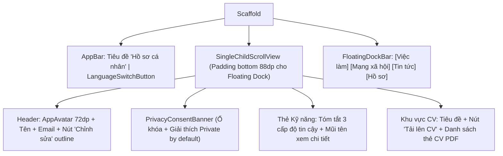

# Đặc Tả Màn Hình: S-09 Hồ Sơ Ứng Viên & Quyền Riêng Tư (S-09-PROFILE.md)

Màn thí điểm 2: Hồ sơ cá nhân, Quyền riêng tư theo mặc định & Quản lý CV (Chuẩn Clay Executive Minimalist).

---

## 1. Mục Tiêu Người Dùng & Tác Vụ Chính
- **Mục tiêu**: Xem và quản lý thông tin định danh nghề nghiệp; kiểm soát quyền riêng tư hồ sơ (Private by default); quản lý danh sách CV PDF; chuyển đổi ngôn ngữ ứng dụng tức thì (`docs/SPEC.md:F-002`, `ADR-0009`).
- **Tác vụ chính**: Xem avatar, tên, email; bật/tắt chế độ hồ sơ riêng tư; tải lên và đặt CV mặc định; đổi ngôn ngữ Việt / Anh; điều hướng sang trang Chỉnh sửa hoặc Kỹ năng.

---

## 2. Thay Đổi So Với Hiện Tại & Lý Do
- **Cũ (`profile_page.dart:24`)**: Dùng `CircleAvatar` tự chế màu `#CFDAF7`; nút đổi ngôn ngữ viết cứng trong AppBar; bố cục dàn trải thiếu phân cấp; tính năng riêng tư mặc định chưa có điểm nhấn bảo mật.
- **Mới**:
  - Header chuẩn Executive: `AppAvatar` 72dp với viền kép tinh tế, họ tên kiểu chữ `TitleLarge`, huy hiệu `[Sinh viên]` hoặc `[Nhà tuyển dụng]` mỏng nhẹ.
  - Banner quyền riêng tư nổi bật: Hộp thẻ xanh ngà `AppColors.primaryContainer` với icon ổ khóa bảo mật giải thích rõ cam kết *"Hồ sơ đang ở chế độ Riêng tư theo mặc định (Chỉ nhà tuyển dụng được bạn ứng tuyển mới xem được)"*.
  - Thẻ CV PDF hiện đại: Hiển thị tên tệp, ngày tải lên, huy hiệu `[Mặc định]` xanh lá và nút menu ba chấm tinh gọn.
  - Tích hợp `LanguageSwitchButton` chuẩn góc phải AppBar.
  - Tương thích Floating Dock ở đáy (bottom padding 88dp).

---

## 3. Bố Cục Mới & Cây Widget Cấp Cao

---

## 4. Các Trạng Thái Giao Diện
- **Mặc định / Có dữ liệu**: Hiển thị đầy đủ thông tin cá nhân và danh sách CV đã nộp.
- **Đang tải (`loading`)**: Header và danh sách CV hiển thị khung xương `AppSkeleton` nhấp nháy êm.
- **Chưa có CV (Rỗng)**: Hiển thị `EmptyStateView` với icon tệp tài liệu và nút bấm *"Tải lên CV đầu tiên để ứng tuyển ngay"* (loại bỏ luồng cụt).
- **Lỗi tải hồ sơ**: Thẻ thông báo lỗi có nút bấm *"Thử lại"* gọi lại usecase.

---

## 5. Dữ Liệu & Hành Động (Gắn với ViewModel Hiện Có)
- Trạng thái từ ViewModels:
  - `AuthProvider.currentUser` $\rightarrow$ Họ tên, email, avatar URL.
  - `CvProvider.cvs`, `CvProvider.isLoading` $\rightarrow$ Danh sách tệp CV và trạng thái tải.
  - `LocaleViewModel.locale` $\rightarrow$ Trạng thái ngôn ngữ hiển thị.
- Hành động gọi ViewModel:
  - Bấm nút Chỉnh sửa $\rightarrow$ Điều hướng tới `/edit-profile`.
  - Bấm Tải lên CV $\rightarrow$ `CvProvider.uploadCv()`.
  - Bấm đặt mặc định $\rightarrow$ `CvProvider.setDefault(cvId)`.
  - Bấm Chuyển cờ $\rightarrow$ `LocaleViewModel.toggleLanguage()`.

---

## 6. Nội Dung & Trợ Năng (l10n & A11y)
- **Khóa l10n sử dụng**: `privateProfileTitle`, `privateProfileSubtitle`, `editProfileTitle`, `languageSwitchTooltip`.
- **A11y**: Đạt chuẩn tương phản chữ Slate 900 trên nền trắng. Nút tải CV và các mục danh sách có vùng chạm $\ge 48\text{dp}$. `Semantics` mô tả đầy đủ: "Hồ sơ riêng tư, trạng thái đang bật".

---

## 7. Tiêu Chí Nghiệm Thu
1. Banner quyền riêng tư luôn hiển thị giải thích rõ tính chất Private by default theo đúng cam kết bảo mật.
2. Thao tác đổi ngôn ngữ cập nhật tức thì toàn bộ nhãn trong màn mà không cần tải lại trang.
3. Danh sách CV cuộn mượt mà và không bị Floating Dock che khuất nút tải lên dưới cùng.

