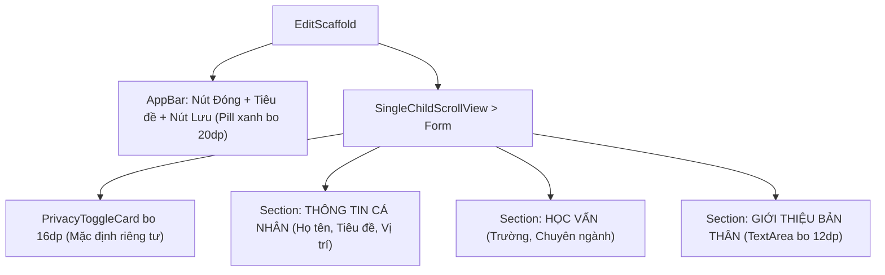

# Đặc Tả Màn Hình: S-10 Chỉnh Sửa Hồ Sơ (S-10-EDIT-PROFILE.md)

Lô 4 - Màn 2: Màn hình cập nhật thông tin cá nhân và cài đặt riêng tư (`docs/SPEC.md:F-002`).

---

## 1. Mục Tiêu Người Dùng & Tác Vụ Chính
- **Mục tiêu**: Cập nhật thông tin cá nhân, định hướng nghề nghiệp và thiết lập chế độ hiển thị hồ sơ bảo vệ quyền riêng tư (`F-002`).
- **Tác vụ chính**: Cập nhật họ tên, tiêu đề nghề nghiệp, địa điểm, trường học, chuyên ngành; chỉnh sửa phần giới thiệu bản thân; bật/tắt chế độ riêng tư mặc định `isPrivate: true` (chuẩn Atom ADR-0010); lưu thay đổi an toàn.

---

## 2. Thay Đổi So Với Hiện Tại & Lý Do
- **Cũ (`edit_profile_page.dart:15`)**:
  - Các ô nhập văn bản xếp chồng rời rạc thiếu cấu trúc phân nhóm; card quyền riêng tư phối màu vàng/xanh thô; nút Lưu ở AppBar thiếu điểm nhấn.
- **Mới (Theo phong cách Clay Executive Minimalist)**:
  - Phân nhóm thông tin có cấu trúc 2 cấp với tiêu đề nhóm in hoa xám Slate 500 (`THÔNG TIN CHÍNH`, `HỌC VẤN`, `GIỚI THIỆU`, `QUYỀN RIÊNG TƯ`).
  - Thẻ quyền riêng tư `PrivacyToggleCard` bo 16dp: Nền xanh nhạt Emerald `#F0FDF4` viền xanh lá mỏng `#86EFAC`, icon khóa an toàn xanh lục `#16A34A`, công tắc gạt hiện đại giải thích rõ: "Nhà tuyển dụng cần bạn đồng ý trước khi xem thông tin chi tiết".
  - Các ô nhập liệu `AppTextField` bo 12dp, nền trắng viền mỏng xám `#E2E8F0`, nhãn phụ nổi bật trên ô nhập, phản hồi lỗi inline màu đỏ nhạt.
  - AppBar hiện đại: Nút Đóng `Icons.close` bên trái, tiêu đề trung tâm, nút "Lưu" pill bo tròn 20dp màu xanh `#2952CC` ở góc phải.

---

## 3. Bố Cục Mới & Cây Widget Cấp Cao


```text
┌──────────────────────────────────────────┐
│ [✕]          Chỉnh sửa hồ sơ     [ Lưu ] │ <- Nút Lưu pill bo 20dp
├──────────────────────────────────────────┤
│ ┌──────────────────────────────────────┐ │
│ │ 🔒 Hồ sơ riêng tư (Mặc định Atom) [●]│ │ <- Card riêng tư bo 16dp
│ │ Nhà tuyển dụng cần bạn cho phép để   │ │
│ │ xem toàn bộ dữ liệu chi tiết.        │ │
│ └──────────────────────────────────────┘ │
│                                          │
│ THÔNG TIN CÁ NHÂN                        │
│ [ Họ và tên                       ]      │ <- Ô nhập bo 12dp
│ [ Tiêu đề nghề nghiệp             ]      │
│ [ Địa điểm (TP. Hồ Chí Minh)      ]      │
│                                          │
│ HỌC VẤN                                  │
│ [ Trường đại học                  ]      │
│ [ Chuyên ngành                    ]      │
│                                          │
│ GIỚI THIỆU BẢN THÂN                      │
│ ┌──────────────────────────────────────┐ │
│ │ Đam mê lập trình Flutter, tìm kiếm  │ │ <- TextArea bo 12dp
│ │ cơ hội thực tập thực tế...          │ │
│ └──────────────────────────────────────┘ │
└──────────────────────────────────────────┘
```

---

## 4. Tất Cả Trạng Thái Giao Diện
- **Mặc định**: Nạp dữ liệu hiện có từ `ProfileEditViewModel`, trạng thái riêng tư được bật mặc định (`isPrivate: true`).
- **Đang chỉnh sửa**: Ô nhập tập trung (focus) có viền xanh `#2952CC` và đổ bóng nhẹ.
- **Đang lưu (`isSubmitting`)**: Nút Lưu chuyển thành vòng quay nhỏ 16dp, khóa các ô nhập liệu.
- **Lưu thành công**: Hiển thị Toast thông báo "Đã cập nhật hồ sơ thành công" và tự động quay về trang cá nhân.
- **Lỗi lưu**: Hiển thị SnackBar lỗi viền đỏ bo 12dp với thông điệp rõ ràng từ máy chủ.

---

## 5. Hành Vi & Hoạt Ảnh
- Gạt công tắc riêng tư: Chuyển đổi trạng thái tức thì với rung nhẹ `HapticFeedback.selectionClick()`.
- Tự động cuộn bàn phím khi nhập các trường ở cuối màn hình.

---

## 6. Dữ Liệu & Hợp Đồng ViewModel
- Sử dụng `ProfileEditViewModel`:
  - Dữ liệu: `vm.profile` (`fullName`, `headline`, `location`, `school`, `major`, `about`, `isPrivate`).
  - Trạng thái: `vm.isSubmitting`, `vm.error`.
  - Phương thức: `vm.updateField(...)`, `vm.save()`.
- Tuyệt đối duy trì giá trị mặc định `isPrivate = true` theo chuẩn Atom (ADR-0010).

---

## 7. Nội Dung & Bản Địa Hóa
- Tiêu đề màn hình: "Chỉnh sửa hồ sơ"
- Nút lưu: "Lưu"
- Tiêu đề card riêng tư: "Hồ sơ riêng tư (Mặc định)"
- Phụ đề card riêng tư: "Khi bật, hồ sơ được bảo vệ riêng tư theo chuẩn Atom. Nhà tuyển dụng cần bạn đồng ý trước khi xem chi tiết."

---

## 8. Trợ Năng & Kiểm Thử
- Mọi trường nhập và nút bấm có chiều cao $\ge 48\text{dp}$.
- Cung cấp Semantics đầy đủ: `Semantics(label: 'Công tắc hồ sơ riêng tư', toggled: isPrivate)`.
- Test keys: `ValueKey('edit_profile_name')`, `ValueKey('edit_profile_headline')`, `ValueKey('edit_profile_privacy_switch')`, `ValueKey('edit_profile_save_btn')`.

---

## 9. Tiêu Chí Nghiệm Thu
1. Hiển thị chuẩn xác các trường thông tin trong form phân nhóm gọn gàng.
2. Công tắc riêng tư luôn hiển thị trạng thái chuẩn xác của `isPrivate`.
3. Bấm Lưu kiểm tra tính hợp lệ dữ liệu và gửi cập nhật về máy chủ.
4. Trở về màn hình hồ sơ phản ánh dữ liệu mới vừa cập nhật.

