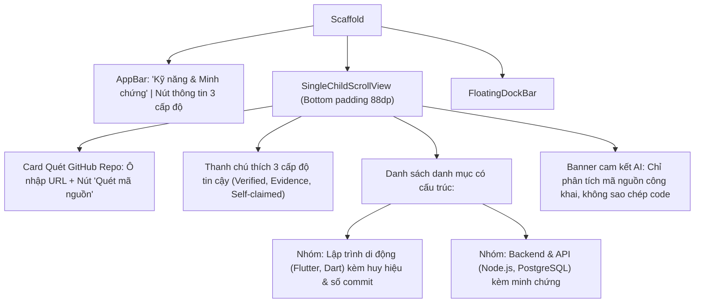

# Đặc Tả Màn Hình: S-11 Kỹ Năng 3 Cấp Độ & Quét Repo (S-11-SKILLS.md)

Màn thí điểm 3: Danh mục kỹ năng minh bạch 3 cấp độ tin cậy & Quét GitHub Repository thay thế CV (`docs/SPEC.md:F-008..010`, `ADR-0010`).

---

## 1. Mục Tiêu Người Dùng & Tác Vụ Chính
- **Mục tiêu**: Xem và chứng minh năng lực lập trình thông qua 3 cấp độ tin cậy minh bạch (Đã xác minh, Có minh chứng Git, Tự khai); quét kho mã nguồn GitHub để tự động trích xuất kỹ năng thực tế (`F-008`).
- **Tác vụ chính**: Khám phá danh sách kỹ năng phân loại theo cấu trúc chuyên môn; xem minh chứng chi tiết của từng skill; nhập link GitHub Repo để quét kỹ năng; cấp quyền AI Consent 0 USD trước khi quét.

---

## 2. Thay Đổi So Với Hiện Tại & Lý Do
- **Cũ (`skills_screen.dart:18`)**: Danh sách kỹ năng dạng danh sách phẳng, chưa gom nhóm danh mục; huy hiệu tin cậy chỉ dựa vào màu sắc; khu vực nhập GitHub Repo tách rời màn khác gây đứt gãy trải nghiệm.
- **Mới**:
  - Phân nhóm kỹ năng có cấu trúc (lấy cảm hứng từ màn Search Clay): Nhóm theo `LẬP TRÌNH & FRAMEWORK`, `CƠ SỞ DỮ LIỆU`, `DEV OPS & TOOLS`.
  - Huy hiệu `ConfidenceBadge` đạt chuẩn: Micro-icon rõ ràng (`[✓ Xanh] Đã kiểm định`, `[⎇ Xám] Minh chứng Git`, `[👤 Nét đứt] Tự khai`), không truyền đạt thông tin duy nhất bằng màu sắc.
  - Card "Up Repo thay CV" tinh tế ngay đầu màn: Ô nhập link GitHub bo 12dp có nút "Quét kỹ năng" (gắn kèm tag "AI 0 USD phân tích cục bộ").
  - Trạng thái chưa cấp quyền AI: Banner nhắc nhở nhẹ nhàng dẫn đến màn `AnalysisConsentScreen` (bảo vệ quyền riêng tư theo ADR-0010).

---

## 3. Bố Cục Mới & Cây Widget Cấp Cao

---

## 4. Các Trạng Thái Giao Diện
- **Mặc định**: Danh sách kỹ năng đã được phân nhóm với đầy đủ huy hiệu 3 cấp độ.
- **Đang quét mã nguồn GitHub**: Ô input khóa tạm thời, nút Quét hiển thị spinner loading xoay nhẹ kèm dòng chữ *"Đang phân tích cấu trúc repository..."*.
- **Chưa có kỹ năng (Rỗng)**: `EmptyStateView` hiển thị minh họa chiếc cúp năng lực và nút *"Thêm kỹ năng đầu tiên"* hoặc *"Quét repo để tự động điền"*.
- **Chưa cấp quyền AI**: Nút quét repo bị vô hiệu hóa kèm nhãn cảnh báo *"Cần cấp quyền phân tích AI nội bộ để tiếp tục"*.

---

## 5. Dữ Liệu & Hành Động (Gắn với ViewModel Hiện Có)
- Trạng thái từ ViewModels:
  - `SkillsViewModel.skills`, `SkillsViewModel.isLoading` $\rightarrow$ Danh mục kỹ năng và cấp độ tin cậy.
  - `RepoUploadViewModel.isScanning`, `repoUrl` $\rightarrow$ Trạng thái quét và URL repo.
  - `ConsentViewModel.hasConsented` $\rightarrow$ Cờ kiểm tra đã đồng ý phân tích AI.
- Hành động gọi ViewModel:
  - Nhập URL repo $\rightarrow$ `RepoUploadViewModel.setRepoUrl(url)`.
  - Bấm Quét repo $\rightarrow$ `RepoUploadViewModel.scanRepo()`.
  - Xem bằng chứng chi tiết $\rightarrow$ Mở bottom sheet hiển thị trích dẫn mã nguồn.

---

## 6. Nội Dung & Trợ Năng (l10n & A11y)
- **Chuỗi cam kết bất biến**: "Đã xác minh", "Có minh chứng mã nguồn", "Tự khai báo" (không được đổi ý nghĩa thành "thành thạo" hay "chuyên gia" theo điều kiện 3.4).
- **A11y**: Mỗi `ConfidenceBadge` có nhãn `Semantics` đọc rõ cấp độ tin cậy cho trình đọc màn hình TalkBack / VoiceOver. Vùng bấm xem minh chứng $\ge 48\text{dp}$.

---

## 7. Tiêu Chí Nghiệm Thu
1. Mọi kỹ năng hiển thị đều gắn đúng 1 trong 3 huy hiệu cấp độ tin cậy với micro-icon tương ứng.
2. Không thể quét GitHub Repo nếu người dùng chưa bật đồng ý AI Consent.
3. Nhập sai cấu trúc GitHub URL sẽ báo lỗi đỏ trực tiếp dưới ô nhập liệu mà không bị crash.

