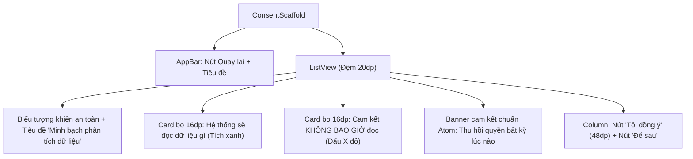

# Đặc Tả Màn Hình: S-12 Đồng Ý Phân Tích Kỹ Năng Tự Động (S-12-ANALYSIS-CONSENT.md)

Lô 4 - Màn 3: Màn hình xin phép phân tích tự động minh bạch theo chuẩn Atom (`docs/SPEC.md:F-006`, ADR-0010).

---

## 1. Mục Tiêu Người Dùng & Tác Vụ Chính
- **Mục tiêu**: Hiểu rõ phạm vi dữ liệu hệ thống AI sẽ truy cập để đo khoảng cách kỹ năng và xác thực năng lực một cách minh bạch, an toàn (`F-006`).
- **Tác vụ chính**: Đọc quyền truy cập được yêu cầu; đọc cam kết bảo mật không truy cập repo riêng tư/secret; bấm "Đồng ý" để cấp quyền hoặc "Để sau" để từ chối mà không bị ép buộc.

---

## 2. Thay Đổi So Với Hiện Tại & Lý Do
- **Cũ (`analysis_consent_screen.dart:15`)**:
  - Giao diện dạng danh sách gạch đầu dòng phẳng, các điểm cam kết chưa tạo được sự nổi bật về mặt thị giác tin cậy.
- **Mới (Theo phong cách Executive Minimalist & Minh bạch chuẩn Atom)**:
  - Header trang trọng: Biểu tượng khiên bảo vệ `Icons.verified_user_outlined` màu xanh `#2952CC` bo tròn 24dp trên nền xanh nhạt `#EEF2FF`.
  - Khối cam kết minh bạch 2 phần phân định rõ ràng bằng màu sắc ngữ nghĩa:
    - Khối 1 (Được phép đọc): Nền trắng bo 16dp viền xanh lá nhạt `#86EFAC`, danh sách tích xanh `Icons.check_circle_outline`: Repo công khai, tệp dependencies (`pubspec.yaml`, `package.json`), nội dung README & JD việc làm.
    - Khối 2 (Tuyệt đối KHÔNG BAO GIỜ đọc): Nền trắng bo 16dp viền đỏ nhạt `#FECDD3`, danh sách dấu X đỏ `Icons.cancel_outlined`: Repo riêng tư (Private), Mật khẩu/token/secret, Dữ liệu lương và liên hệ cá nhân.
  - Thẻ cam kết bảo vệ dữ liệu Atom: Khẳng định quyền thu hồi đồng ý bất kỳ lúc nào trong Cài đặt cá nhân.
  - Chân trang hành động kép: Nút "Tôi đồng ý" pill bo 20dp xanh `#2952CC` cao 48dp, bên dưới là nút "Để sau" chữ xám Slate 600 để tránh dark pattern.

---

## 3. Bố Cục Mới & Cây Widget Cấp Cao


```text
┌──────────────────────────────────────────┐
│ [←]         Đồng ý phân tích tự động     │
├──────────────────────────────────────────┤
│                  🛡️                      │
│      Minh bạch dữ liệu theo Atom         │
│                                          │
│ ┌──────────────────────────────────────┐ │
│ │ ✓ HỆ THỐNG SẼ ĐỌC:                   │ │ <- Card xanh lá bo 16dp
│ │ • Các GitHub repo công khai bạn cấp   │ │
│ │ • File khai báo thư viện (pubspec...) │ │
│ │ • README & cấu trúc thư mục gốc      │ │
│ └──────────────────────────────────────┘ │
│                                          │
│ ┌──────────────────────────────────────┐ │
│ │ ✕ CAM KẾT KHÔNG BAO GIỜ ĐỌC:         │ │ <- Card đỏ nhạt bo 16dp
│ │ • Repository riêng tư (Private)      │ │
│ │ • Mật khẩu, token hoặc file secret   │ │
│ │ • Dữ liệu lương hay thông tin cá nhân│ │
│ └──────────────────────────────────────┘ │
│                                          │
│ [🔒 Có thể thu hồi quyền trong Cài đặt]  │
│                                          │
│ [        Tôi đồng ý (48dp)            ]  │ <- Nút pill xanh bo 20dp
│                 Để sau                   │ <- Nút text ghost
└──────────────────────────────────────────┘
```

---

## 4. Tất Cả Trạng Thái Giao Diện
- **Chưa cấp quyền**: Hiển thị đầy đủ thông tin cam kết và 2 nút hành động.
- **Đang xử lý đồng ý**: Nút "Tôi đồng ý" hiển thị vòng quay 16dp, khóa tương tác nút "Để sau".
- **Đồng ý thành công**: Gọi `vm.grantConsent()`, trả về `true` và đóng màn hình về luồng trước đó.
- **Từ chối / Để sau**: Trả về `false` và quay về an toàn không ép buộc người dùng.

---

## 5. Hành Vi & Hoạt Ảnh
- Chạm "Tôi đồng ý": Rung phản hồi xúc giác nhẹ `HapticFeedback.mediumImpact()`.
- Chuyển tiếp mượt mà quay về màn hình Up Repo hoặc Hồ sơ.

---

## 6. Dữ Liệu & Hợp Đồng ViewModel
- Sử dụng `ConsentViewModel`:
  - Dữ liệu: `vm.granted`.
  - Phương thức: `vm.grantConsent()`, `vm.revokeConsent()`.
- Tuyệt đối giữ nguyên nội dung cam kết pháp lý về bảo mật dữ liệu và quyền riêng tư mặc định.

---

## 7. Nội Dung & Bản Địa Hóa
- Tiêu đề AppBar: "Đồng ý phân tích tự động"
- Danh sách đọc: "Các repository GitHub công khai...", "File khai báo thư viện..."
- Danh sách cấm đọc: "Các repository riêng tư (Private repositories)...", "Mật khẩu, token hoặc thông tin bí mật..."
- Nút đồng ý: "Tôi đồng ý"
- Nút từ chối: "Để sau"

---

## 8. Trợ Năng & Kiểm Thử
- Các nút bấm đạt chiều cao tối thiểu $48\text{dp}$.
- Độ tương phản chữ cảnh báo đỏ $\ge 4.5:1$ trên nền sáng.
- Test keys: `ValueKey('consent_agree_btn')`, `ValueKey('consent_later_btn')`.

---

## 9. Tiêu Chí Nghiệm Thu
1. Các điều khoản đọc và không đọc được phân tách rõ ràng bằng màu ngữ nghĩa.
2. Nút "Để sau" dễ bấm, không sử dụng dark pattern đánh lừa.
3. Bấm đồng ý lưu trạng thái `granted = true` thành công và quay lại luồng gọi.

