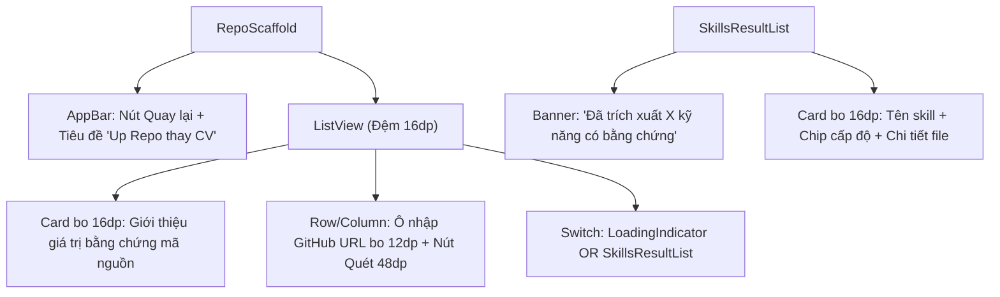

# Đặc Tả Màn Hình: S-13 Bằng Chứng Repo GitHub (S-13-REPO-EVIDENCE.md)

Lô 4 - Màn 4: Màn hình quét kho mã nguồn GitHub trích xuất bằng chứng kỹ năng (`docs/SPEC.md:F-008`).

---

## 1. Mục Tiêu Người Dùng & Tác Vụ Chính
- **Mục tiêu**: Thay thế CV truyền thống bằng bằng chứng năng lực thực tế từ các commit và mã nguồn dự án GitHub công khai (`F-008`).
- **Tác vụ chính**: Nhập URL repo GitHub; tự động kích hoạt màn hình xin phép đồng ý phân tích (nếu chưa cấp); xem kết quả kỹ năng trích xuất phân hạng theo 3 cấp độ tin cậy; lưu vào hồ sơ năng lực.

---

## 2. Thay Đổi So Với Hiện Tại & Lý Do
- **Cũ (`repo_upload_screen.dart:17`)**:
  - Ô nhập GitHub URL đơn điệu; kết quả hiển thị danh sách thô sơ; chưa làm nổi bật giá trị của bằng chứng năng lực mã nguồn.
- **Mới (Theo phong cách Executive Minimalist)**:
  - Header hiện đại: Biểu tượng nhánh Git `Icons.fork_right_rounded` trên nền xanh Indigo nhạt `#EEF2FF`, tiêu đề: "Minh chứng kỹ năng từ mã nguồn thực tế".
  - Ô nhập URL repo GitHub `AppTextField` bo 12dp: Kèm icon GitHub, nút dán nhanh (Paste), và nút "Quét Repo" pill bo 20dp xanh `#2952CC` cao 48dp.
  - Tích hợp cổng xin phép Atom: Nếu người dùng chưa cấp quyền, hệ thống điều hướng sang `AnalysisConsentScreen` trước khi quét repo.
  - Danh sách kỹ năng trích xuất: Thẻ bo 16dp nền trắng viền mỏng xám `#E2E8F0`, hiển thị micro-chip phân loại 3 cấp độ tin cậy chuẩn quy tắc sản phẩm:
    - Xanh lá `#10B981`: `VERIFIED` ("Đã xác thực qua mã nguồn").
    - Xanh tím `#6366F1`: `EVIDENCE_BASED` ("Có hoạt động mã nguồn đáng kể - không hiển thị 'thành thạo' để tránh ngộ nhận").
    - Xám Slate `#64748B`: `SELF_CLAIMED` ("Tự khai").
  - Mỗi thẻ kỹ năng hiển thị bằng chứng chi tiết: Ngôn ngữ chính, các thư viện nhận diện được (`pubspec.yaml`, `package.json`), và số lượng commit liên quan.

---

## 3. Bố Cục Mới & Cây Widget Cấp Cao


```text
┌──────────────────────────────────────────┐
│ [←]            Up Repo thay vì CV        │
├──────────────────────────────────────────┤
│ ┌──────────────────────────────────────┐ │
│ │ ⎇  MINH CHỨNG NĂNG LỰC THỰC TẾ       │ │ <- Intro Card bo 16dp
│ │ Hệ thống phân tích commit & tệp      │ │
│ │ thư viện để xác thực kỹ năng của bạn.│ │
│ └──────────────────────────────────────┘ │
│                                          │
│ Đường dẫn GitHub Repository              │
│ [ https://github.com/user/my-project   ] │ <- Ô nhập bo 12dp
│ [             Quét Repo (48dp)         ] │ <- Nút pill xanh bo 20dp
│                                          │
│ KẾT QUẢ PHÂN TÍCH (3 KỸ NĂNG)            │
│ ┌──────────────────────────────────────┐ │
│ │ Flutter              [⎇ Có hoạt động]│ │ <- Evidence Card bo 16dp
│ │ Bằng chứng: pubspec.yaml, 28 commits │ │
│ ├──────────────────────────────────────┤ │
│ │ Dart                 [✓ Đã xác thực] │ │
│ │ Bằng chứng: lib/main.dart, 120 files │ │
│ └──────────────────────────────────────┘ │
└──────────────────────────────────────────┘
```

---

## 4. Tất Cả Trạng Thái Giao Diện
- **Chưa quét**: Hiển thị ô nhập URL và hướng dẫn các bước thực hiện.
- **Đang quét mã nguồn (`isScanning == true`)**: Hiển thị thanh tiến trình quét với nhãn: "Đang phân tích cấu trúc mã nguồn và commit...".
- **Quét thành công**: Hiển thị danh sách kỹ năng trích xuất cùng chip cấp độ tin cậy.
- **Repo không công khai / không tồn tại**: Card báo lỗi bo 16dp viền đỏ nhạt, gợi ý kiểm tra lại đường dẫn hoặc trạng thái public của repo.

---

## 5. Hành Vi & Hoạt Ảnh
- Bấm nút Quét: Kiểm tra `ConsentViewModel.granted`, tự động mở `AnalysisConsentScreen` nếu chưa đồng ý.
- Kết quả kỹ năng trượt nhẹ lên (slide-up 200ms) sau khi phân tích hoàn tất.

---

## 6. Dữ Liệu & Hợp Đồng ViewModel
- Sử dụng `RepoUploadViewModel`:
  - Dữ liệu: `vm.isScanning`, `vm.skillsExtracted`, `vm.error`.
  - Phương thức: `vm.scanRepo({required bool hasConsent})`.
- Sử dụng `ConsentViewModel`:
  - Trạng thái: `consentVm.granted`.
- Tuyệt đối tuân thủ quy tắc sản phẩm: Cấp độ "có bằng chứng" chỉ ghi "có hoạt động mã nguồn đáng kể", không dùng từ "thành thạo" hay hiển thị như chứng chỉ.

---

## 7. Nội Dung & Bản Địa Hóa
- Tiêu đề AppBar: "Up Repo thay vì CV"
- Nhãn nút quét: "Quét Repo"
- Nhãn trạng thái đang quét: "Đang phân tích mã nguồn..."
- Cấp độ tin cậy: "Đã xác thực", "Có hoạt động mã nguồn", "Tự khai"

---

## 8. Trợ Năng & Kiểm Thử
- Ô nhập URL và nút Quét có chiều cao tối thiểu $48\text{dp}$.
- Cung cấp Semantics cho từng chip bằng chứng kỹ năng.
- Test keys: `ValueKey('repo_url_input')`, `ValueKey('repo_scan_btn')`, `ValueKey('repo_skill_card_<skill>')`.

---

## 9. Tiêu Chí Nghiệm Thu
1. Nhập URL GitHub hợp lệ và kích hoạt quét repo.
2. Tự động kiểm tra quyền đồng ý phân tích AI trước khi gửi lệnh quét.
3. Kỹ năng hiển thị đúng 3 mức độ tin cậy minh bạch, không ngộ nhận chứng chỉ.

