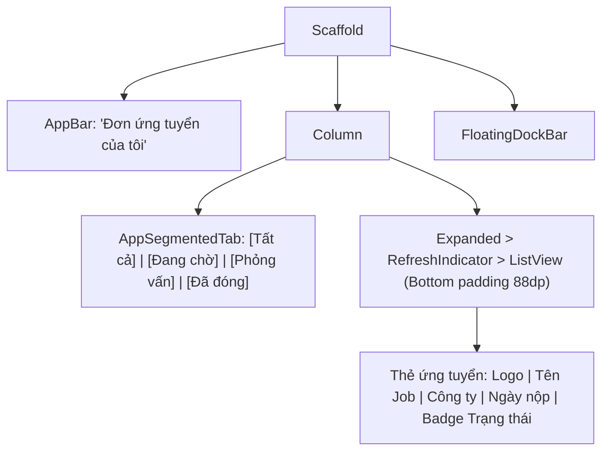

# Đặc Tả Màn Hình: S-14 Đơn Ứng Tuyển Của Tôi (S-14-APPLICATIONS.md)

Lô 2 - Màn 4: Theo dõi và quản lý hồ sơ ứng tuyển sinh viên (`docs/SPEC.md:F-007`).

---

## 1. Mục Tiêu Người Dùng & Tác Vụ Chính
- **Mục tiêu**: Nắm bắt tiến trình xét duyệt của các đơn ứng tuyển đã nộp vào các doanh nghiệp; biết rõ trạng thái hiện tại (Đang xét duyệt, Mời phỏng vấn, Từ chối) (`F-007`).
- **Tác vụ chính**: Lọc đơn ứng tuyển theo trạng thái; xem chi tiết công việc đã nộp; xem ngày nộp và phản hồi từ nhà tuyển dụng; rút đơn ứng tuyển nếu cần.

---

## 2. Thay Đổi So Với Hiện Tại & Lý Do
- **Cũ (`applications_page.dart:13`)**: Danh sách đơn điệu, khi rỗng tạo luồng cụt (lỗi P1-2); badge trạng thái chỉ có màu sắc đơn giản; thiếu phân nhóm trạng thái.
- **Mới**:
  - Segmented Tab trạng thái ở đầu trang: `[Tất cả]`, `[Đang chờ]`, `[Phỏng vấn]`, `[Hoàn tất]`.
  - Thẻ ứng tuyển bo 16dp: Logo công ty tròn 40dp, tên vị trí `TitleMedium`, ngày nộp và huy hiệu trạng thái `ApplicationStatusBadge` (Vàng cho Đang xét duyệt, Xanh lá cho Mời phỏng vấn, Xám cho Đã đóng).
  - Trạng thái rỗng hoàn thiện (Empty State): Khi chưa có đơn, hiển thị `EmptyStateView` với hình minh họa thư ứng tuyển và nút bấm Primary *"Khám phá việc làm ngay"* (dẫn người dùng quay về tab Jobs, loại bỏ hoàn toàn luồng cụt P1-2).
  - Khoảng đệm cuộn đáy `bottomPadding: 88dp` tương thích Floating Dock.

---

## 3. Bố Cục Mới & Cây Widget Cấp Cao

---

## 4. Các Trạng Thái Giao Diện
- **Mặc định / Có danh sách**: Danh sách thẻ ứng tuyển hiển thị rõ ràng, sắp xếp theo thời gian nộp gần nhất.
- **Đang tải (`loading`)**: Khung xương `AppSkeleton` nhấp nháy êm dịu 3 thẻ mẫu.
- **Chưa có đơn ứng tuyển (Rỗng)**: `EmptyStateView` hiển thị minh họa và nút chuyển ngay sang tab Việc làm.
- **Lỗi tải dữ liệu**: Thẻ báo lỗi có nút bấm *"Thử lại"* gọi usecase làm mới danh sách.

---

## 5. Dữ Liệu & Hành Động (Gắn với ViewModel Hiện Có)
- Trạng thái từ `StudentApplicationsProvider` (`features/applications/.../student_applications_provider.dart:10`):
  - `provider.applications` $\rightarrow$ Danh sách đơn ứng tuyển `List<ApplicationEntity>`.
  - `provider.isLoading` $\rightarrow$ Trạng thái đang tải.
- Hành động gọi ViewModel:
  - Kéo xuống làm mới $\rightarrow$ `provider.loadApplications()`.
  - Bấm vào thẻ $\rightarrow$ Điều hướng tới xem lại chi tiết việc làm.

---

## 6. Nội Dung & Trợ Năng (l10n & A11y)
- **Chuỗi l10n**: `applicationsTitle` ("Đơn ứng tuyển của tôi"), `appStatusPending` ("Đang xét duyệt"), `appStatusInterview` ("Mời phỏng vấn"), `appStatusRejected` ("Từ chối"), `appEmptyExplore` ("Khám phá việc làm ngay").
- **A11y**: Huy hiệu trạng thái có icon đi kèm chữ (không chỉ dùng màu). Vùng chạm thẻ $\ge 48\text{dp}$.

---

## 7. Tiêu Chí Nghiệm Thu
1. Trạng thái rỗng luôn có nút hành động dẫn người dùng quay lại khám phá danh sách việc làm.
2. Badge trạng thái hiển thị đúng màu ngữ nghĩa và icon đi kèm.
3. Không bị Floating Dock che khuất đơn ứng tuyển cuối cùng trong danh sách.

