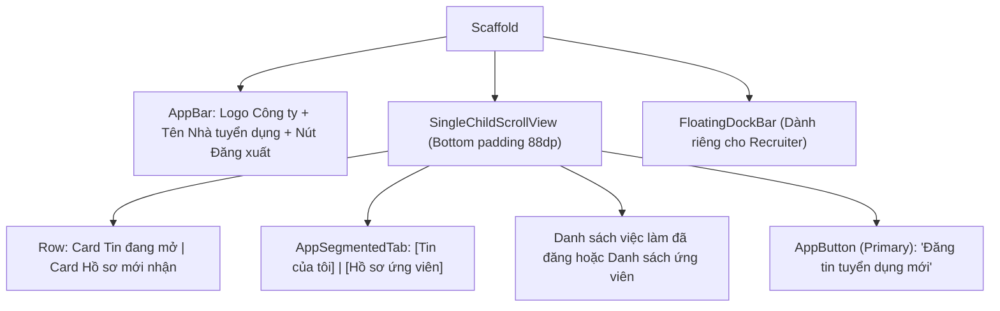

# Đặc Tả Màn Hình: S-15 Không Gian Nhà Tuyển Dụng (S-15-RECRUITER.md)

Lô 2 - Màn 5: Bảng điều khiển quản lý tin tuyển dụng và hồ sơ ứng viên (`docs/SPEC.md:F-011`).

---

## 1. Mục Tiêu Người Dùng & Tác Vụ Chính
- **Mục tiêu**: Hỗ trợ nhà tuyển dụng quản lý các tin đăng tuyển, theo dõi ứng viên ứng tuyển và xem hồ sơ kỹ năng của ứng viên (`F-011`).
- **Tác vụ chính**: Xem danh sách tin tuyển dụng đang mở; xem số lượng hồ sơ đã nộp; mở danh sách ứng viên; xem mức độ phù hợp kỹ năng của ứng viên; đăng tin tuyển dụng mới.

---

## 2. Thay Đổi So Với Hiện Tại & Lý Do
- **Cũ (`recruiter_home_screen.dart:14`)**: Giao diện quản trị thô sơ, thiếu thẻ thống kê trực quan; danh sách tin đăng tuyển hiển thị phẳng thiếu điểm nhấn.
- **Mới**:
  - Thẻ tóm tắt nhanh (Quick Metric Cards) ở đầu trang: 2 thẻ bo 16dp hiển thị `[Tin đang mở: 4]` và `[Hồ sơ mới: 12]` với icon tinh gọn.
  - Phân loại rõ ràng 2 tab: `[Tin tuyển dụng]` và `[Ứng viên mới]`.
  - Danh sách tin tuyển dụng bo 16dp: Hiển thị tên vị trí, mức lương, hạn nộp, và số lượng ứng viên nộp hồ sơ kèm huy hiệu cảnh báo tin sắp hết hạn.
  - Nút nổi hoặc Footer Action: "Đăng tin tuyển dụng mới" màu xanh Primary đạt chuẩn vùng chạm 48dp.

---

## 3. Bố Cục Mới & Cây Widget Cấp Cao

---

## 4. Các Trạng Thái Giao Diện
- **Mặc định / Có tin đăng**: Hiển thị bảng điều khiển và danh sách việc làm đang mở.
- **Chưa đăng tin nào (Rỗng)**: `EmptyStateView` hiển thị minh họa tòa nhà doanh nghiệp và nút *"Đăng tin tuyển dụng đầu tiên"*.
- **Đang tải (`loading`)**: `AppSkeleton` tải thẻ thống kê và danh sách tin.
- **Lỗi tải dữ liệu**: Banner lỗi có nút thử lại.

---

## 5. Dữ Liệu & Hành Động (Gắn với ViewModel Hiện Có)
- Trạng thái từ `AuthProvider` và `RecruiterJobsDataSource`:
  - `authProvider.currentUser` $\rightarrow$ Tên công ty, avatar nhà tuyển dụng.
  - Dữ liệu tin tuyển dụng từ API nhà tuyển dụng.
- Hành động:
  - Bấm Đăng tin mới $\rightarrow$ Mở form đăng tin tuyển dụng.
  - Bấm xem ứng viên $\rightarrow$ Mở danh sách ứng viên của vị trí đó.

---

## 6. Nội Dung & Trợ Năng (l10n & A11y)
- **Chuỗi l10n**: `recruiterHomeTitle` ("Bảng điều khiển tuyển dụng"), `recruiterActiveJobs` ("Tin đang mở"), `recruiterNewApplicants` ("Hồ sơ mới"), `recruiterPostJob` ("Đăng tin mới").
- **A11y**: Thẻ số liệu có nhãn Semantics đọc rõ: "Tin tuyển dụng đang mở: 4 tin".

---

## 7. Tiêu Chí Nghiệm Thu
1. Hiển thị chính xác vai trò Nhà tuyển dụng và tên công ty trên thanh Header.
2. Thẻ số liệu co giãn linh hoạt trên mọi kích thước màn hình mà không bị vỡ dòng.
3. Nút đăng tin mới luôn nổi bật và dễ thao tác trên thiết bị di động.

